# 실리콘 탄성체의 혼합·진공 탈포 및 열경화 실험
**실험일: 2026년 10월 15일 | 보고서 작성용 초안**

## 1. 실험 목적

실리콘 탄성체 주제와 경화제를 10:1 질량비로 혼합한 뒤, 진공 탈포와 몰드 주입 및 열경화 과정을 실습한다. 각 공정에서 기포 발생과 제거 과정을 관찰하고, 시편 제작 시 주의할 사항을 정리한다.

## 2. 재료 및 장비

실리콘 탄성체 주제(Base A), 경화제(Curing Agent), 전자저울, 혼합 용기, 교반 도구, 진공 챔버, 몰드, 가열 장비, 장갑, 티슈 및 소독용 분무액을 사용하였다. 재료 병의 라벨에서 주제와 경화제 표기를 확인하였으며, 정확한 제품명과 소독액 성분은 추가 확인이 필요하다.

| 재료 준비 | 소독 작업 |
| --- | --- |
| 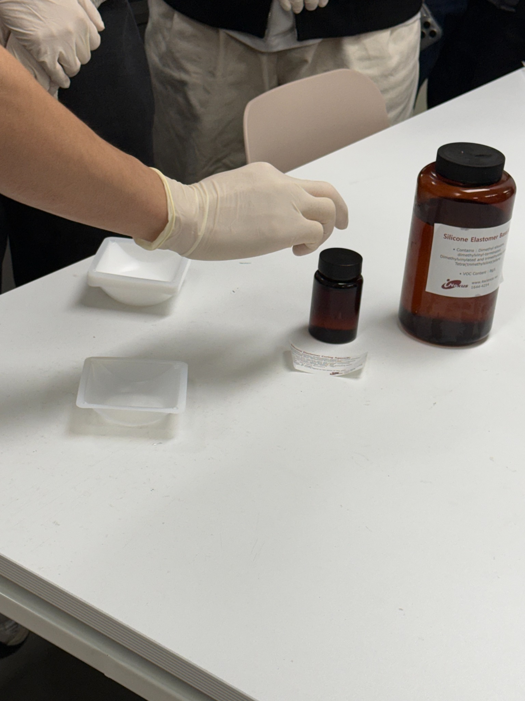 | 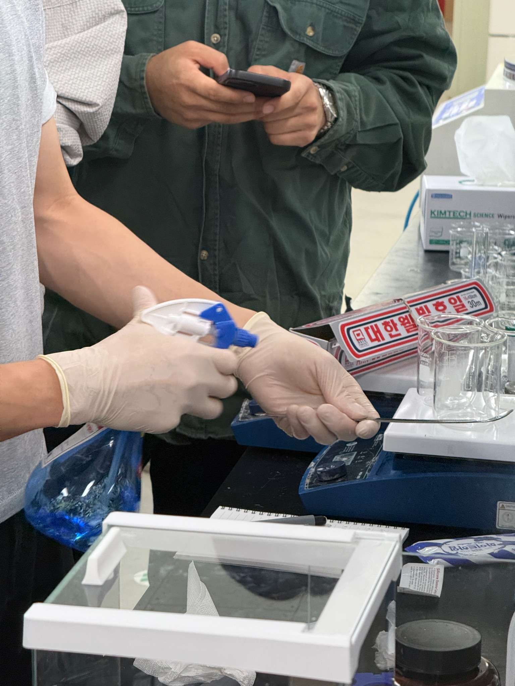 |
| **그림 1.** 주제·경화제 및 혼합 용기 준비. | **그림 2.** 분무액을 이용한 소독 장면. 성분은 미기록. |

## 3. 실험 방법

### 3.1. 준비 및 계량

작업 공간과 도구를 깨끗하게 소독하고 흘림에 대비해 티슈를 깔았다. 혼합 용기를 전자저울 위에 올려 영점을 맞춘 뒤 주제와 경화제를 계량하였다. 처음에는 10~20 g 범위를 생각했으나, 메모에 기록한 최종 배합량은 **주제 9 g, 경화제 0.9 g**으로, 질량비는 **10:1**, 총량은 **9.9 g**이다.

| 저울 조작 | 용기 취급 |
| --- | --- |
| 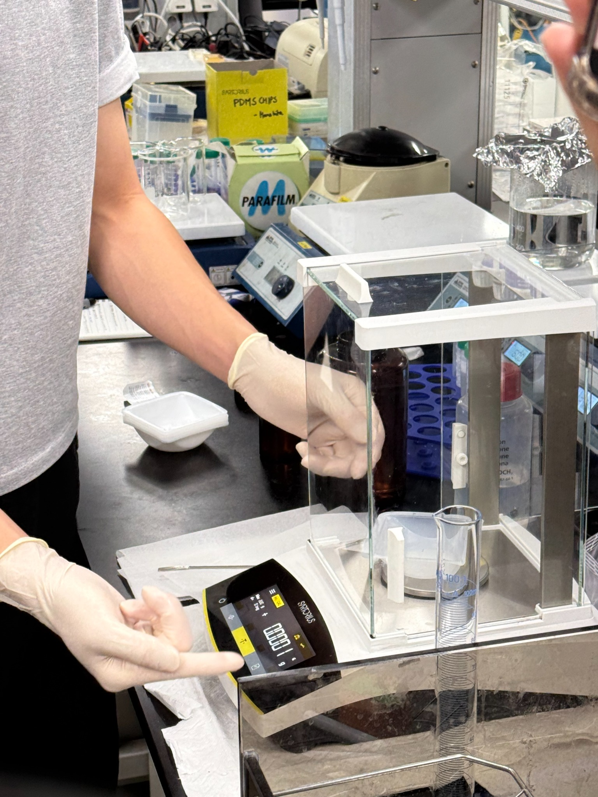 | 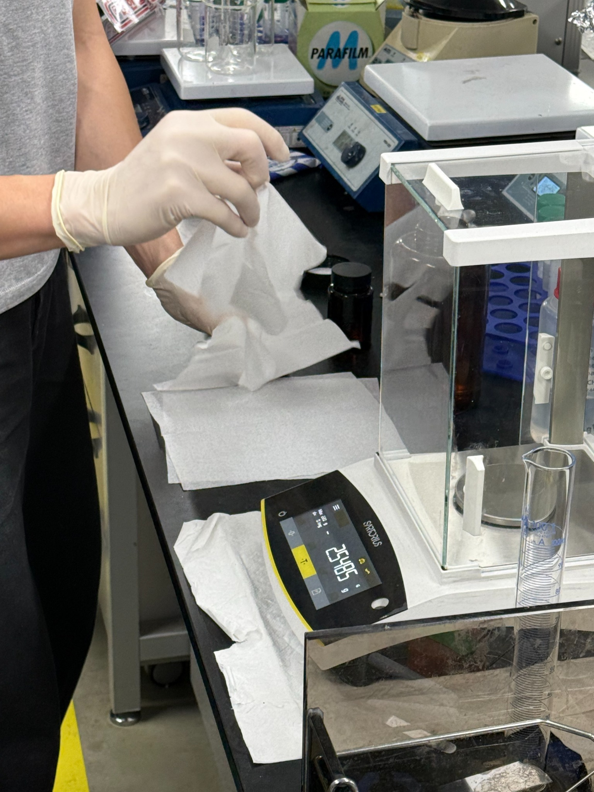 |
| **그림 3.** 용기를 올린 상태에서 전자저울을 조작하는 모습. | **그림 4.** 티슈를 깐 작업대에서 용기를 취급하는 모습. |

| 주제 투입 | 경화제 투입 |
| --- | --- |
| 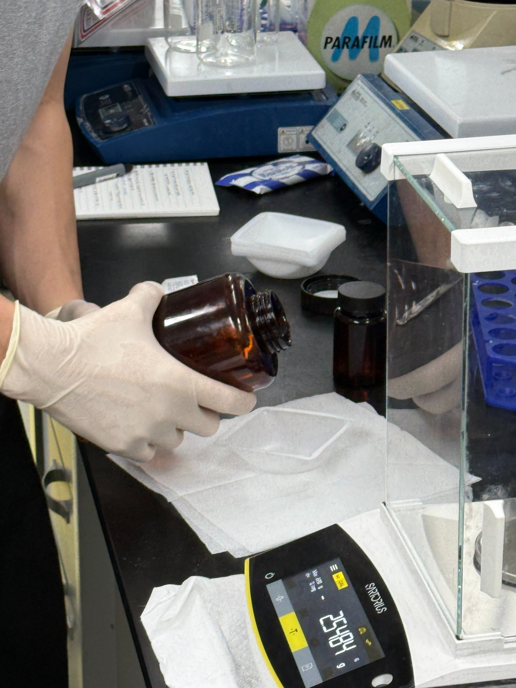 | 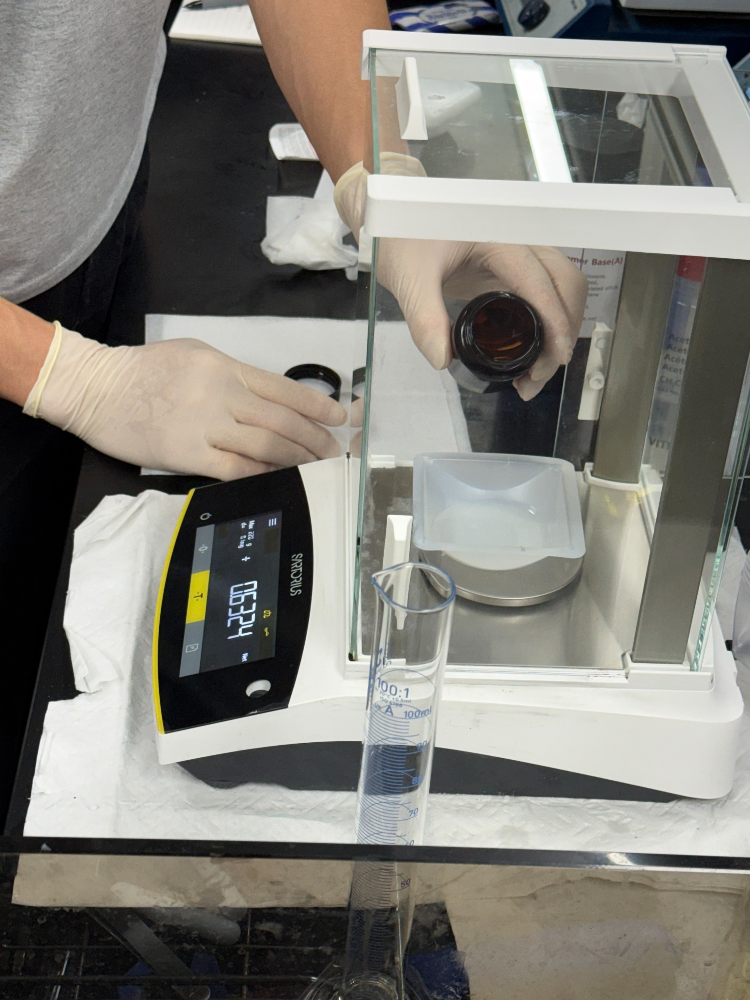 |
| **그림 5.** 주제를 혼합 용기에 붓는 장면. | **그림 6.** 경화제를 추가하는 장면. |

> 사진의 저울 표시는 계량 도중 값이며 최종 배합량의 증거로 사용하지 않았다. 최종량 9 g과 0.9 g은 사용자 메모를 기준으로 작성하였다.

### 3.2. 혼합 및 진공 탈포

계량한 재료를 교반 도구로 약 200회 저어 충분히 혼합하였다. 메모에는 기포가 많이 생길 때까지 저었다고 기록되어 있다. 혼합 후 용기를 진공 챔버에 넣고, 기포가 팽창해 넘치지 않도록 상태를 살피며 공기를 조절하였다. 이후 혼합물을 챔버에서 꺼냈다.

| 혼합 | 진공 챔버 조작 |
| --- | --- |
| 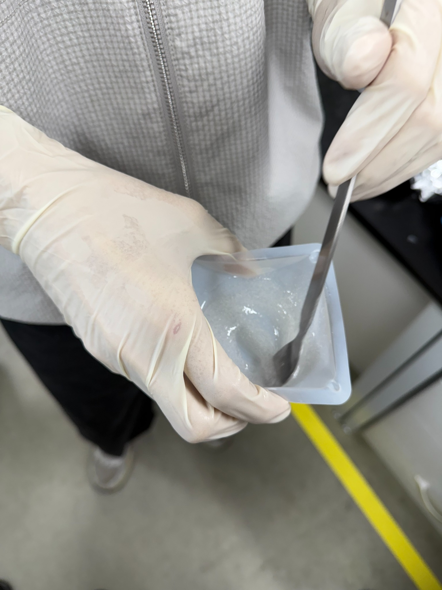 | 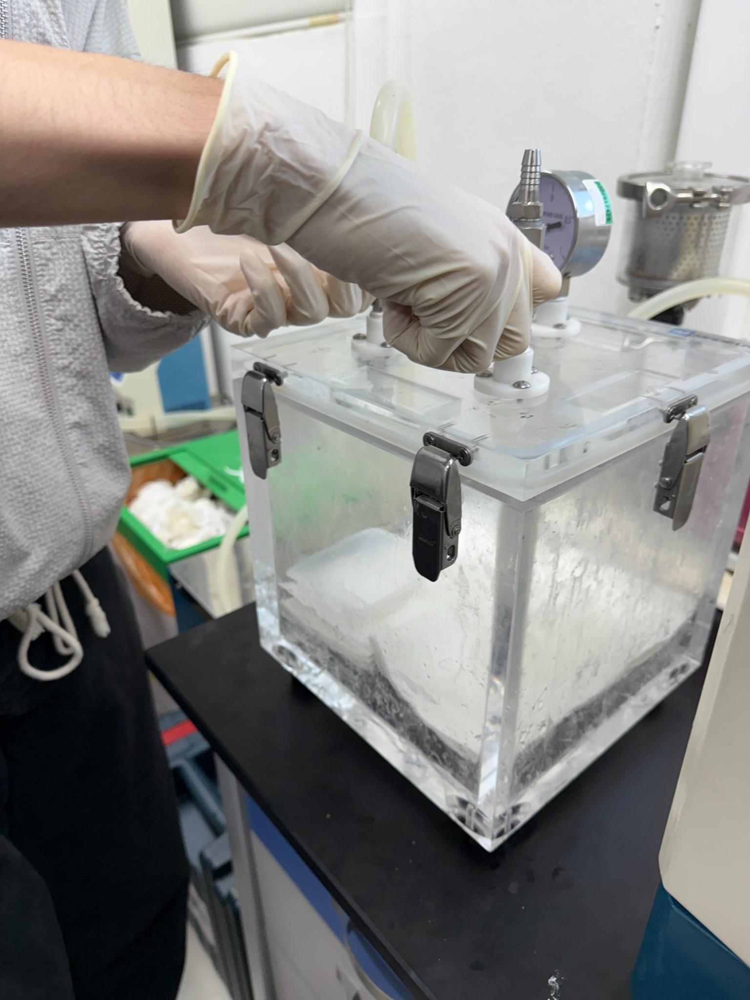 |
| **그림 7.** 주제와 경화제를 교반하는 장면. | **그림 8.** 탈포 과정에서 진공 챔버를 조작하는 모습. |

| 밸브 조작 | 챔버에서 꺼낸 혼합물 |
| --- | --- |
| 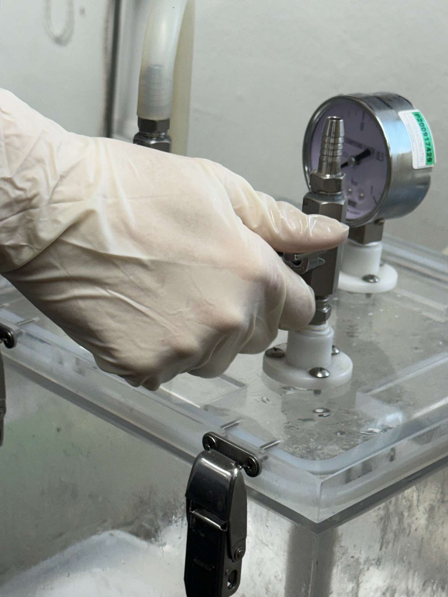 | 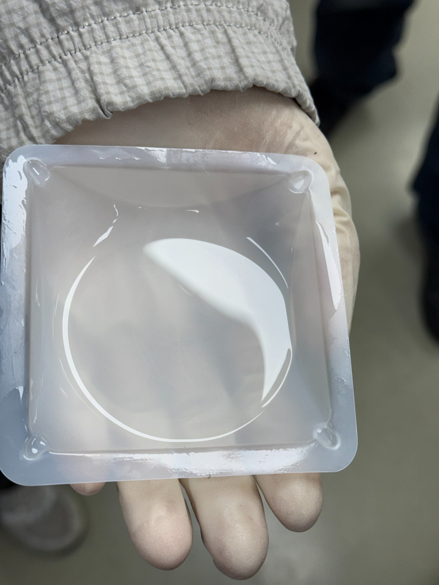 |
| **그림 9.** 압력계 옆 밸브를 조작하는 모습. 압력값은 확정하지 않았다. | **그림 10.** 메모상 챔버에서 꺼낸 혼합물. 사진만으로 미세 기포의 완전 제거 여부는 판단하기 어렵다. |

### 3.3. 몰드 주입·잔여 기포 제거 및 열경화

탈포한 혼합물을 준비된 몰드에 부었다. 주입 후 남은 기포는 뾰족한 도구로 터뜨려 제거하였다. 이후 열을 가해 굳히는 공정을 진행하였다. 경화 온도와 시간은 기록되지 않았다.

| 몰드 주입 | 잔여 기포 제거 |
| --- | --- |
| 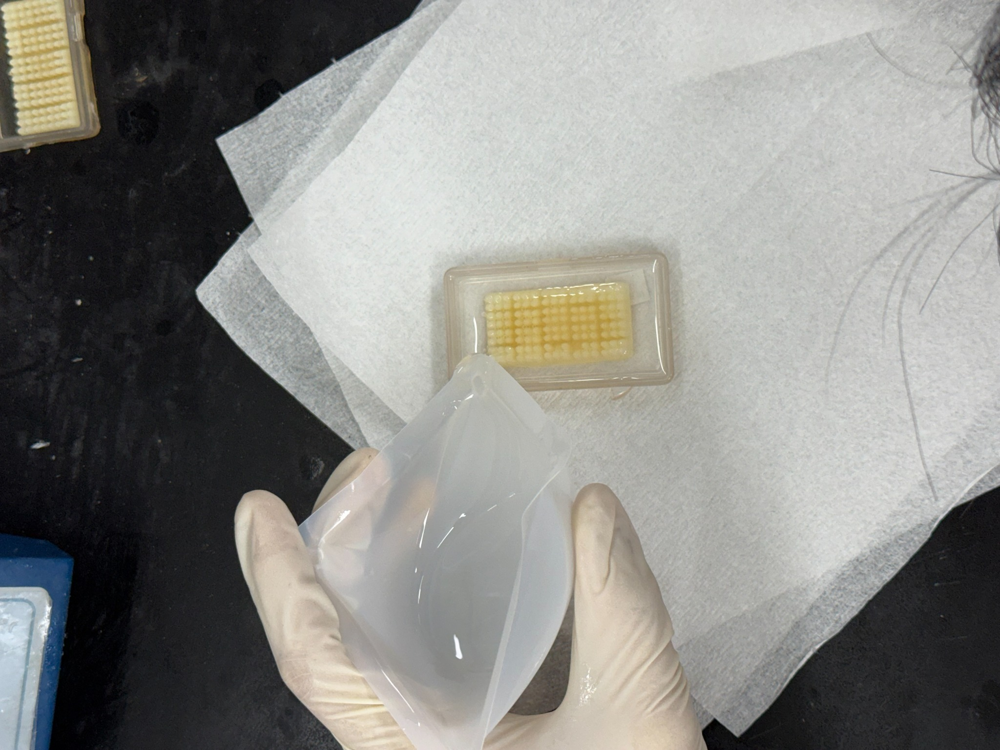 | 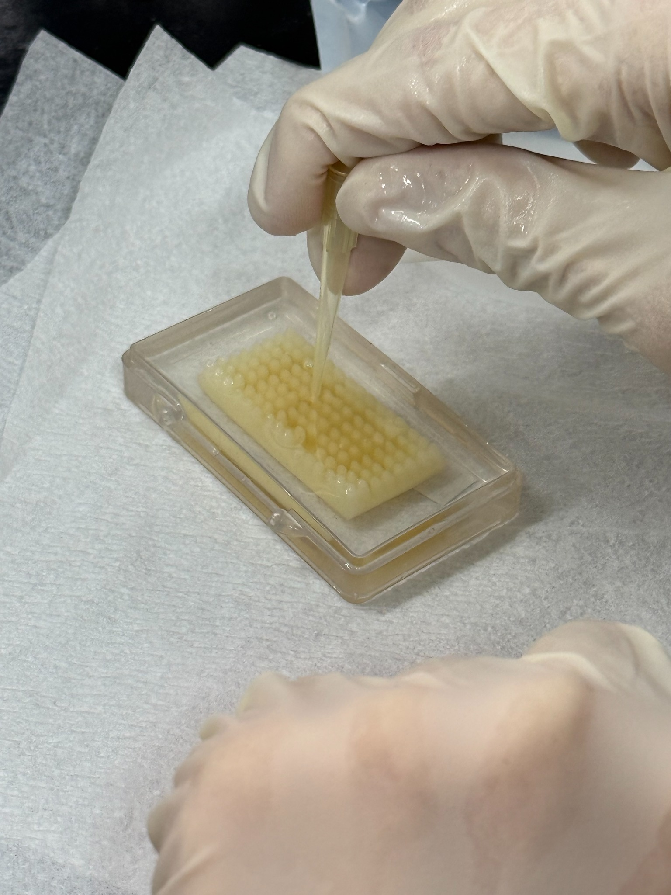 |
| **그림 11.** 패턴이 있는 몰드에 혼합물을 붓는 장면. | **그림 12.** 메모상 잔여 기포를 터뜨리는 장면. |

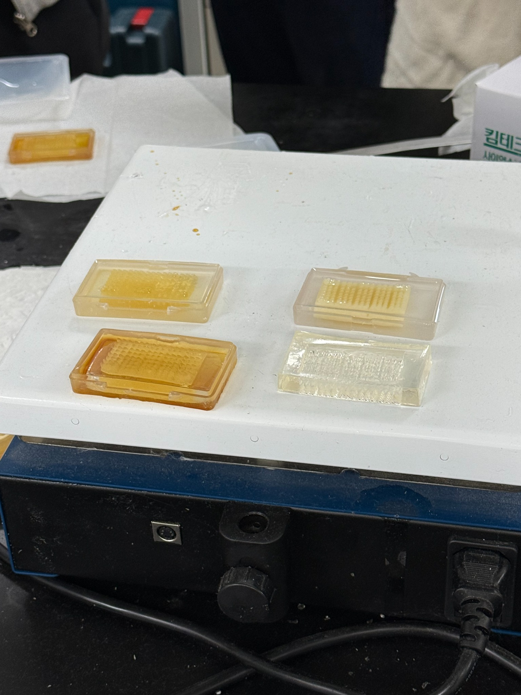

**그림 13.** 가열 장비 위에 놓인 몰드와 시편. 사진만으로 경화 완료 여부나 각 시편의 제작 이력을 확정하지 않았다.

## 4. 결과 및 고찰

사진에서 재료의 계량·교반, 진공 챔버 조작, 몰드 주입과 표면 처리 과정을 확인하였다. 메모상 배합량은 주제 9 g과 경화제 0.9 g이며, 혼합 후 탈포하고 몰드에 부어 열경화하는 순서로 실습하였다.

혼합 단계에서는 두 재료를 고르게 섞는 동시에 기포가 유입될 수 있으므로, 기포를 많이 만드는 것 자체를 혼합의 목표로 삼기보다 충분한 혼합 후 탈포하는 공정으로 설명하는 것이 적절하다. 이번 실습에서는 진공 챔버 사용 중 넘침을 방지하기 위한 공기 조절과, 몰드 주입 후 남은 기포를 제거하는 작업을 수행하였다. 다만 기포 개수, 시편 두께, 경도 및 경화 전후 상태를 정량 측정하지 않아 탈포 효과나 시편의 균일성을 수치로 평가하지는 못하였다.

경화된 시편 위에서 세포를 배양할 수 있다는 설명을 들었으나, 이번 기록에는 실제 세포배양 결과가 없다. 또한 ‘영구적으로 이용 가능’이라는 메모만으로 사용 수명이나 반복 사용 성능을 확정할 수 없다.

## 5. 결론

실리콘 탄성체의 10:1 배합, 혼합, 진공 탈포, 몰드 주입 및 열경화 공정을 실습하였다. 제작 과정에서는 배합량 확인과 기포 관리가 주요 작업이었다. 최종 보고서에는 제품명, 탈포 조건, 경화 온도·시간과 경화 후 시편 상태를 보완해야 한다.

## 기록 근거 및 보완 사항

- 본문은 사용자 메모와 제공 사진을 바탕으로 작성하였다. 설명용 문헌 검토는 아직 포함하지 않았다.
- 제공 사진 15장 중 동일 파일인 003(001과 동일), 007(006과 동일)을 제외한 **고유 사진 13장**을 수록하였다.
- 사진 번호의 날짜는 전달 파일명 기준이며, 실험일 10월 15일은 사용자 메모를 따른다.
- **추가 확인:** 정확한 재료 제품명, 소독액 성분, 탈포 시간·압력, 경화 온도·시간, 최종 시편의 외형·두께·경도.
