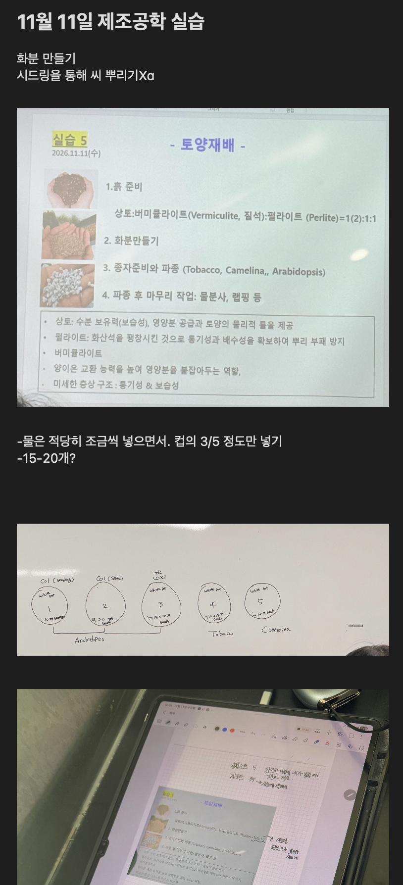
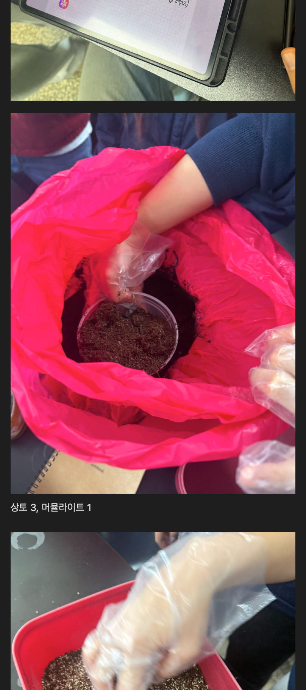
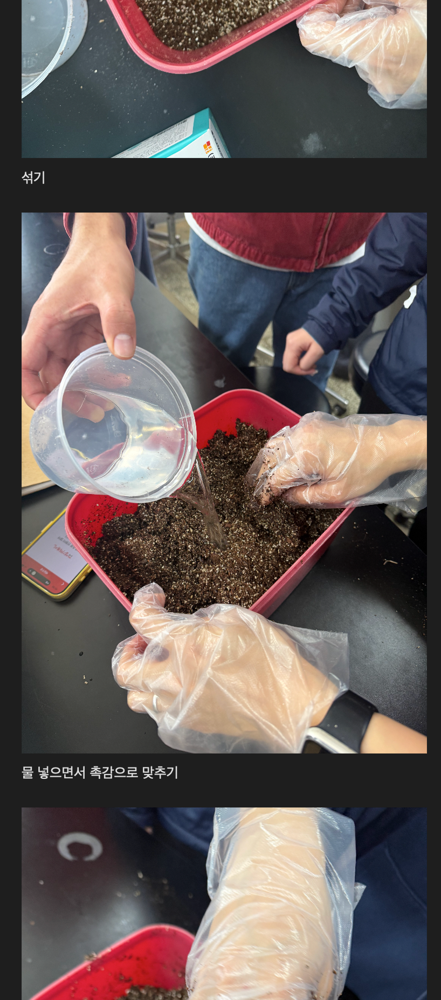
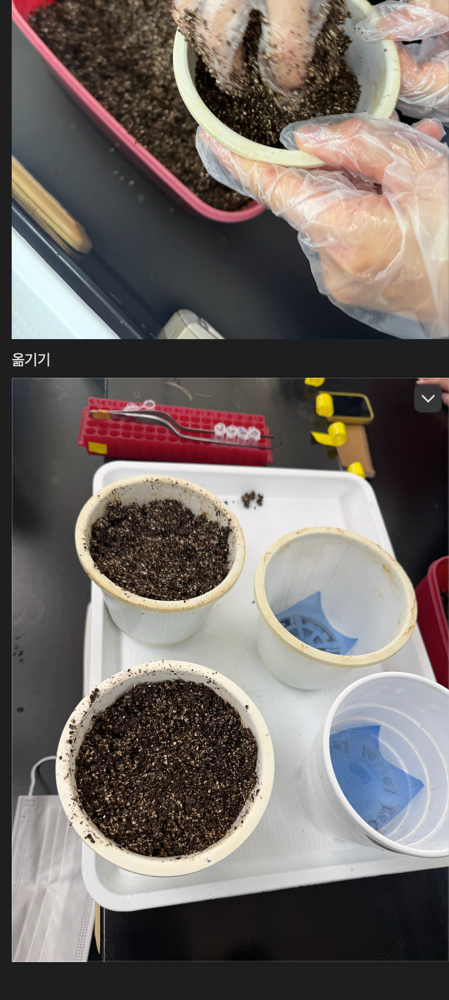
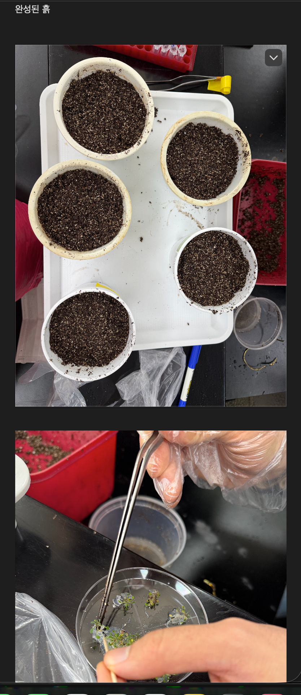
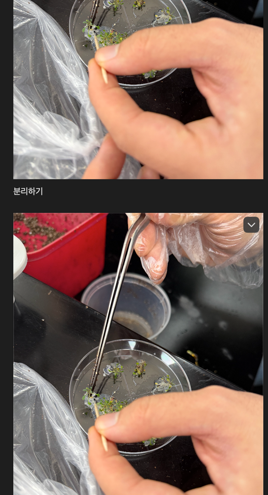
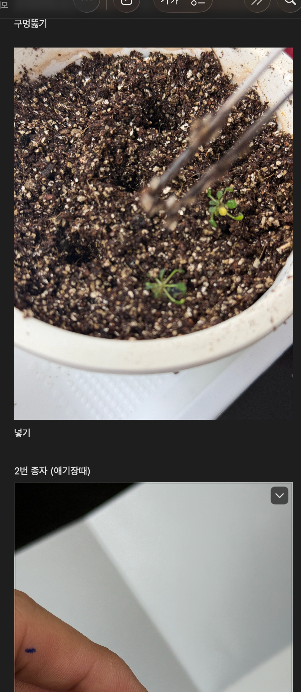
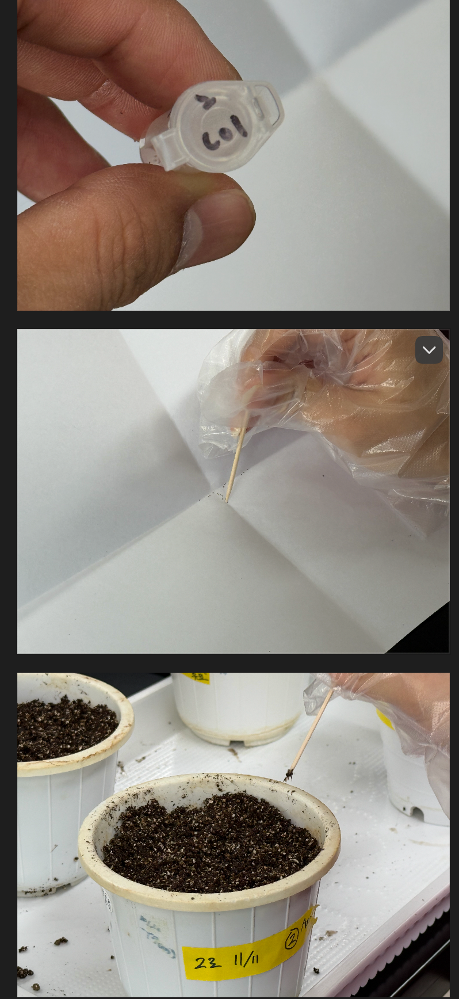
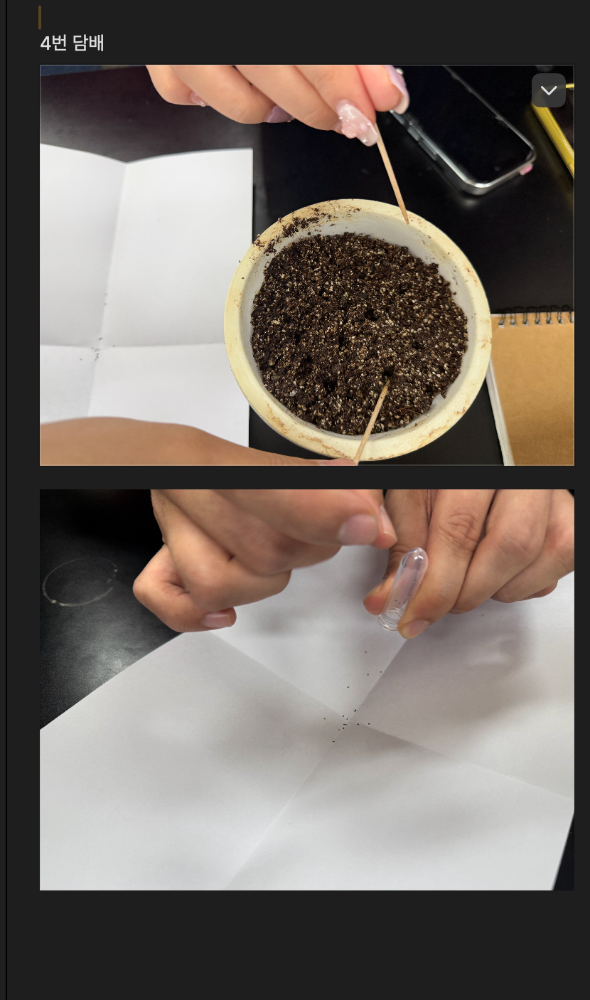
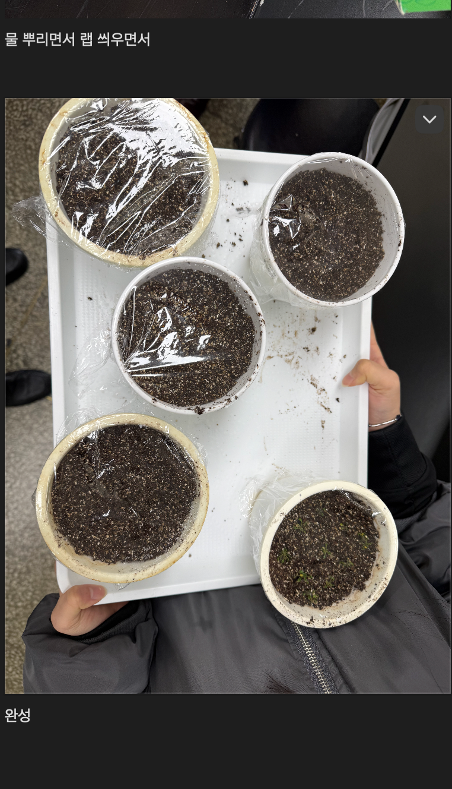

# 실습 5 — 토양재배 및 파종

**실험일: 2026년 11월 11일(수) | 사진·메모 기반 실험일지**

> 기록 범위: 배양토 준비, 화분 제작, 애기장대 유묘 이식, 종자 파종 및 마무리 작업. **사진에서 확인한 사실**, **메모·수업자료의 안내**, **추가 확인이 필요한 항목**을 구분하였다. 발아율이나 이식 후 생존율은 측정 결과로 제시하지 않았다.

## 1. 실험 목적 및 이론적 배경

배양토를 혼합하고 화분을 준비한 뒤, 배양 용기의 애기장대 유묘를 토양으로 옮겨 심는 과정과 애기장대·담배·카멜리나 종자를 파종하는 과정을 실습한다. 유묘 이식과 종자 파종을 구분하여 기록하고, 이후 활착과 발아를 관찰할 기준을 남긴다.

수업자료에는 상토가 수분 보유, 양분 공급 및 토양의 물리적 틀 제공에 관여하고, 버미큘라이트(질석)는 보수성과 양분 보유에, 펄라이트는 통기성과 배수성에 관여한다고 설명되어 있다. 아래 설명은 **수업에서 제시된 원리**이며, 이번 실습에서 각 재료의 효과를 비교·측정한 결과는 아니다. 파종 후 물 공급과 랩 처리는 수분 관리 작업으로 정리하되, 실제 습도나 수분 유지 효과는 측정하지 않았다.

**그림 1.** 실습 날짜와 토양재배 수업자료, 화분 구분도 및 메모. 수업자료의 배합비와 현장 메모의 배합비는 구분하여 기록하였다. 원본 이미지에서 판서와 메모를 함께 확인할 수 있다.

## 2. 재료 및 장비

| 구분 | 확인 내용 | 기록의 한계 |
| --- | --- | --- |
| 배양토 재료 | 상토, 버미큘라이트로 해석되는 혼합 재료 | 사용자 메모는 `상토 3, 머뮬라이트 1`로 표기. 후자는 수업자료의 버미큘라이트를 뜻하는 것으로 해석했으며 제품명은 미확인 |
| 수업자료에 제시된 재료 | 상토, 버미큘라이트, 펄라이트 | 펄라이트를 별도로 실제 투입했는지와 투입량은 확인되지 않음 |
| 식물 재료 | 애기장대 유묘, 애기장대·담배·카멜리나 종자 | 종 구분은 판서·메모에 근거. 3번 애기장대 계통의 정확한 명칭과 처리 조건은 미확인 |
| 용기·도구 | 화분 및 컵형 용기, 배수망, 트레이, 혼합 용기, 물을 담은 용기, 배양 접시, 핀셋, 이쑤시개, 종이, 종자 튜브, 장갑, 라벨, 랩 | 규격·제품명·멸균 여부는 기록되지 않음 |

### 화분 번호별 구분

아래 번호는 그림 1의 구분도를 따른다. 구분도에 적힌 개수는 **안내 또는 계획 수량으로 취급**하며, 실제 이식·파종 완료 개수를 계수한 결과로 보지 않았다.

| 화분 | 구분도·메모의 식물/표기 | 작업 구분 | 판서의 수량 표기 | 실제 확인 범위 |
| --- | --- | --- | --- | --- |
| 1 | 애기장대, `Col (seedling)` | 유묘 이식 | `10개 seedling`으로 읽힘 | 유묘 분리와 토양 이식 장면 확인. 최종 개체 수 미계수 |
| 2 | 애기장대, `Col (seed)` | 종자 파종 | `약 20개 seed`로 읽힘 | `2번 종자 (애기장대)` 메모, `Col` 표기 튜브 및 파종 장면 확인 |
| 3 | 애기장대, 상단 계통 표기 판독 불확실 | 종자 파종으로 구분 | `15~20개 seeds`로 읽힘 | 구분도상 배치 확인. 계통명·처리 조건·실제 파종 수 추가 확인 필요 |
| 4 | 담배, `Tobacco` | 종자 파종 | `10~15개 seeds`로 읽힘 | `4번 담배` 메모와 파종 작업 장면 확인 |
| 5 | 카멜리나, `Camelina` | 종자 파종으로 구분 | `10개 seeds`로 읽힘 | 구분도상 배치 확인. 개별 파종 완료 장면 및 실제 종자 수를 따로 확정하지 않음 |

> 별도 메모의 `15~20개?`에는 물음표가 있으며 적용 대상도 명시되어 있지 않다. 이를 모든 화분의 실제 파종 수나 반복 수로 사용하지 않았다. 화분 5개는 작업 구분이며 동일 조건의 반복 실험 5회라는 뜻이 아니다.

## 3. 실험 방법

### 3.1. 배양토 혼합 및 수분 조절

상토를 용기에 덜고 혼합 재료와 섞었다. 사용자 메모에는 `상토 3, 머뮬라이트 1`이라고 기록되어 있어 **메모상 배합비는 상토:버미큘라이트 = 3:1**로 정리하였다. 질량비인지 부피비인지, 실제 계량량이 얼마인지는 기록되어 있지 않다.

수업자료에는 **상토:버미큘라이트:펄라이트 = `1(2):1:1`**로 표기되어 있다. 이 표기는 수업 안내로 따로 보존하며, 현장 메모의 3:1과 같은 배합으로 간주하지 않았다. 사진만으로 재료별 투입량이나 펄라이트 별도 사용 여부를 판정하지 않았다.

혼합물에 물을 넣으며 장갑을 낀 손으로 섞었다. 메모의 `물 넣으면서 촉감으로 맞추기`에 따라 촉감으로 수분 상태를 조절한 과정으로 기록하였다. 첨가한 물의 부피와 최종 토양 수분함량은 미기록이다.

| 재료를 덜고 혼합하기 | 물을 넣으며 섞기 |
| --- | --- |
|  |  |
| **그림 2.** 재료 취급 및 3:1 메모. 재료별 실제 질량·부피는 확인되지 않는다. | **그림 3.** 물 첨가와 혼합. 수분 상태는 촉감으로 맞췄다는 메모가 있으며 정량 측정값은 없다. |

### 3.2. 배수망 설치 및 화분 준비

빈 화분과 컵형 용기 바닥에 배수망을 놓고 혼합 배양토를 옮겨 담았다. 준비 사진에서 배수망이 놓인 빈 용기와 배양토를 채운 용기가 함께 확인된다. 이후 트레이에 배양토가 담긴 용기 **총 5개**가 놓인 모습을 확인하였다.

그림 1의 메모에는 `컵의 3/5 정도만 넣기`라고 적혀 있으나, 물을 담는 컵의 양인지 화분에 넣는 배양토 양인지 명확하지 않다. 따라서 **화분을 높이의 3/5까지 채웠다고 확정하지 않았다.** 용기 용량과 배양토 충전 높이·질량도 측정값으로 기록하지 않았다.

| 배양토 옮기기와 배수망 | 배양토를 담은 용기 |
| --- | --- |
|  |  |
| **그림 4.** 배양토 충전과 배수망 설치 상태. 사진에 보이는 일부 용기를 근거로 모든 용기의 배수 구조를 단정하지 않았다. | **그림 5.** 준비된 용기 5개. 아래쪽에는 배양 접시에서 유묘를 다루는 장면이 포함되어 있다. |

### 3.3. 애기장대 유묘 이식 — 1번 화분

배양 접시의 식물체를 핀셋과 이쑤시개로 분리하였다. 배양토에 구멍을 내고 분리한 식물체를 옮겨 심는 순서가 사진과 `분리하기`, `구멍뚫기`, `넣기` 메모에서 확인된다. 이 단계는 이미 자란 유묘를 옮기는 작업으로, 종자 파종과 구분하였다.

분리·이식 과정에서는 식물체와 뿌리를 조심스럽게 취급할 필요가 있다. 다만 사진만으로 뿌리 손상이 없었다거나 이식 후 활착에 성공했다고 판단하지 않았다. 배양배지 조성, 유묘 일령, 이식 깊이 및 최종 이식 수는 미기록이다.

| 배양 접시에서 유묘 분리 | 배양토에 옮겨 심기 |
| --- | --- |
|  |  |
| **그림 6.** 유묘 분리 장면. 연속 스크린샷에 같은 장면이 반복되어 있어 별도 반복 실험으로 세지 않았다. | **그림 7.** 토양 이식 과정. 보이는 녹색 식물체는 이식한 유묘이며 이번에 파종한 종자의 발아 증거가 아니다. |

### 3.4. 종자 준비 및 파종 — 2~5번 화분

종자를 작은 튜브에서 종이 위로 옮기고, 이쑤시개로 집어 배양토 표면에 놓는 작업을 진행하였다. 2번은 `애기장대`라는 메모와 `Col` 표기 튜브가, 4번은 `담배`라는 메모와 작업 사진이 확인된다. 3번과 5번은 화분 구분도에 근거하여 정리했으며, 각 화분의 파종 완료 여부와 정확한 종자 수를 개별 사진만으로 확정하지 않았다.

종자 간격, 파종 깊이, 복토 여부·두께, 종자 소독 및 저온 처리 여부는 확인 가능한 메모에 명시되어 있지 않다. 사진의 종자나 점을 세어 최종 파종 수로 환산하지 않았다.

| 2번 애기장대 종자 취급·파종 | 4번 담배 메모 및 종자 취급 |
| --- | --- |
|  |  |
| **그림 8.** 종자 튜브, 종이 및 이쑤시개를 이용한 파종. 라벨에서 2번과 11/11 표기를 확인할 수 있다. | **그림 9.** `4번 담배` 메모와 관련 작업 사진. 실제 투입 종자 수는 미계수이다. |

### 3.5. 물 공급·랩 처리 및 마무리

메모에는 `물 뿌리면서 랩 씌우면서`라고 기록되어 있다. 따라서 마무리 물 공급은 **메모에 근거한 수행 내용**으로 기록하였고, 물의 양·분무 횟수는 미기록으로 남겼다. 최종 사진에서 5개 용기를 확인하였으며, 일부 용기 위에 투명 랩이 덮인 모습과 유묘가 있는 용기를 확인하였다. 모든 용기의 밀봉 상태, 랩을 유지한 기간 및 제거 시점은 확인되지 않는다.

**그림 10.** 마무리 상태. 랩, 배양토 및 이식된 식물체가 보인다. 사진상 배치만으로 2~5번 용기의 번호와 종을 다시 배정하지 않았다.

## 4. 결과 및 고찰

### 4.1. 당일 관찰 결과

| 항목 | 확인한 내용 | 해석의 한계 |
| --- | --- | --- |
| 배양토 준비 | 재료를 섞고 물을 넣어 혼합하는 과정 | 배합비는 메모에 근거하며 실제 계량 기록과 수분 측정값은 없음 |
| 화분 제작 | 배수망을 놓은 용기, 배양토 충전 및 용기 5개 준비 | 각 용기의 배양토 양·용량·배수 성능은 미측정 |
| 유묘 이식 | 배양 접시에서 식물체를 분리하고 토양으로 옮긴 모습 | 총 이식 수, 뿌리 손상 여부, 생존·활착률은 미확인 |
| 종자 파종 | 종이와 이쑤시개로 종자를 취급하여 파종하는 과정 | 번호별 실제 종자 수와 파종 균일성은 미측정 |
| 마무리 | 라벨, 일부 용기의 랩 및 최종 용기 5개 확인. 물 공급은 메모에 기록 | 관수량·습도·랩 처리 시간은 미기록 |
| 발아 및 이후 생장 | 후속 관찰 자료 없음 | 발아율, 발아일, 생장량 및 처리 간 우열을 제시할 수 없음 |

### 4.2. 고찰

이번 기록의 핵심은 **유묘 이식과 종자 파종의 시작 상태가 다르다는 점**이다. 1번 화분의 녹색 식물체는 배양 접시에서 옮겨 심은 유묘이므로 2~5번 화분의 발아 결과와 함께 계산해서는 안 된다. 이식군은 이식한 개체의 생존과 새 잎 발생을, 파종군은 실제 파종 수와 발아 수를 각각 추적해야 한다.

배양토 조성은 현장 메모의 3:1과 수업자료의 `1(2):1:1`이 서로 다르다. 실제 사용 재료, 배합 기준 및 투입량을 확인하기 전에는 어느 조성의 효과로 결과를 설명할 수 없다. 또한 수분을 촉감으로 조절한 기록만으로 토양 수분함량이 일정했다거나 각 화분의 조건이 같았다고 판단할 수 없다.

최종 사진은 작업 당일의 외관을 보여 주며 이후의 발아·활착 성공을 증명하지 않는다. 화분별 식물 재료와 시작 상태가 다르고 실제 투입 수 및 재배 환경 기록이 부족하므로, 이번 자료만으로 종이나 처리 간 생장 차이를 비교하거나 통계적인 결론을 내리지 않았다.

## 5. 결론 및 후속 관찰 계획

배양토 혼합과 수분 조절, 화분 준비, 애기장대 유묘 이식, 종자 파종 및 랩을 이용한 마무리 작업을 기록하였다. 당일 최종 사진에서는 용기 5개와 이식된 식물체, 일부 용기의 랩을 확인하였다. 이후 발아와 활착 여부는 후속 관찰로 판단해야 한다.

다음 관찰 시 아래 항목을 보완한다. 아래 표는 **기록 계획이며 수행 완료나 측정 결과가 아니다.**

| 관찰 대상 | 다음에 기록할 항목 |
| --- | --- |
| 공통 | 화분 번호·종/계통 라벨, 관찰 날짜·시간, 같은 방향의 전체 사진, 배양 장소·온도·광조건, 물 공급량, 랩 유지·제거 시점 |
| 1번 이식군 | 최초 이식 개체 수 확인, 생존 개체 수, 시듦·잎색 변화·새 잎 발생 |
| 2~5번 파종군 | 번호별 실제 파종 수 확인, 첫 발아 관찰일, 발아 개체 수 및 판단 기준 |
| 기록 보완 | 실제 배양토 재료와 혼합 기준, 3번의 계통·처리 조건, 3번·5번 파종 기록 |

실제 파종 수 또는 이식 수가 확인되지 않으면 발아율·생존율을 계산하지 않고 관찰 개체 수만 기록한다. 후속 관찰에서 확인한 사실은 해당 관찰일을 붙여 추가한다.

## 기록 근거 및 보완 사항

- 사용자 제공 사진·메모가 포함된 **스크린샷 원본 10장**을 직접 확인하여 본문에 수록하였다. 날짜는 수업자료의 `2026.11.11(수)`와 사용자 요청을 따른다.
- 이전 대화에는 최초 사진 20장과 추가 이미지 10장의 업로드 기록이 있다. 이번 일지의 직접 검증 범위는 확보된 추가 스크린샷 10장이다. 여러 현장 사진이 한 스크린샷에 포함되고 일부 장면이 중복되므로, 이를 독립된 현장 사진 30장 또는 반복 실험 횟수로 계산하지 않았다.
- 스크린샷을 자르거나 내용을 바꾸지 않고 보존하였다. 그림 1~10은 원본 파일명의 시각 순서(11:33:17~11:34:19)에 대응하며, 이 시각은 스크린샷 파일명일 뿐 각 실험 단계의 수행 시각이 아니다.
- 이론적 배경은 그림 1의 수업자료와 작업 목적을 정리한 것이다. 별도의 문헌 검토나 재료 성능 측정 결과를 추가하지 않았다.
- **수치 구분:** 용기 5개는 사진으로 확인. 3:1, `1(2):1:1`, 3/5, 화분별 개수 및 `15~20개?`는 각각 메모·수업자료의 표기이며 위 본문에 해석과 불확실성을 명시하였다.
- **추가 확인:** 실제 배합 재료·기준·계량량, 물 공급량, 3/5 메모의 대상, 3번 계통과 처리 조건, 화분별 이식·파종 수, 종자 전처리, 재배 환경, 랩 유지 기간, 후속 발아·활착 결과.
