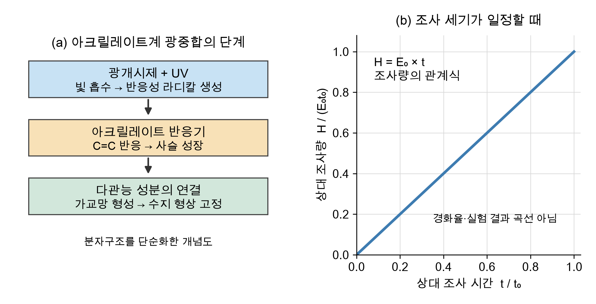
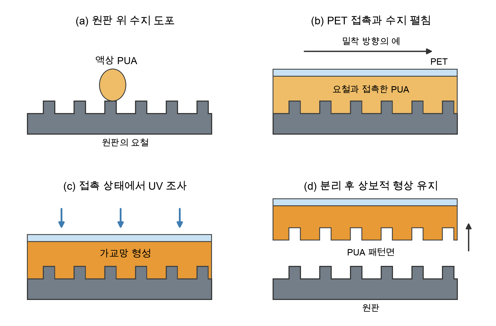
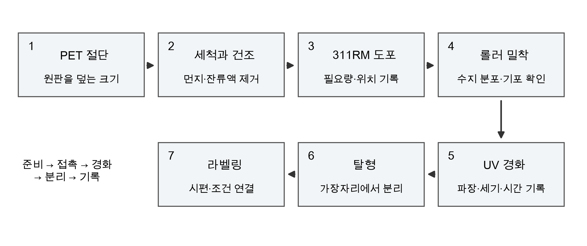
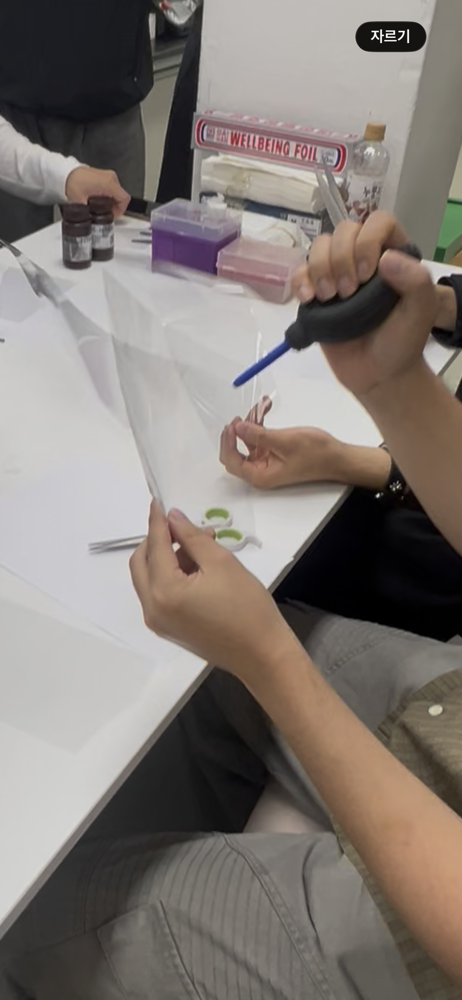
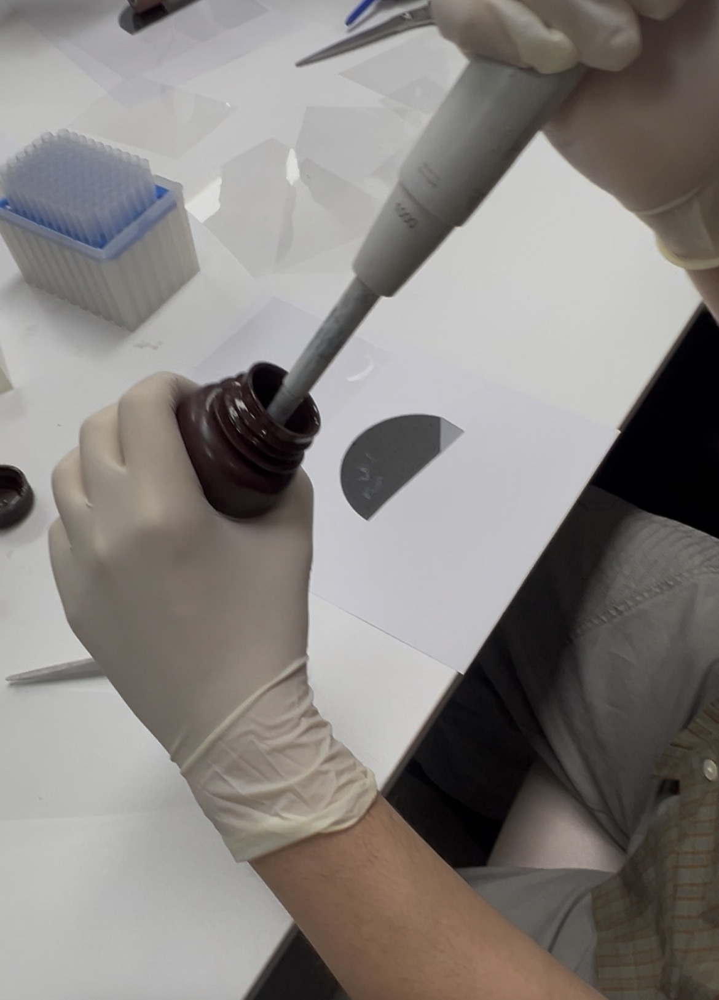
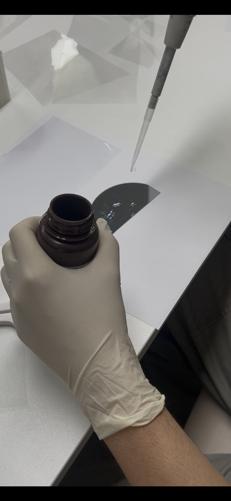
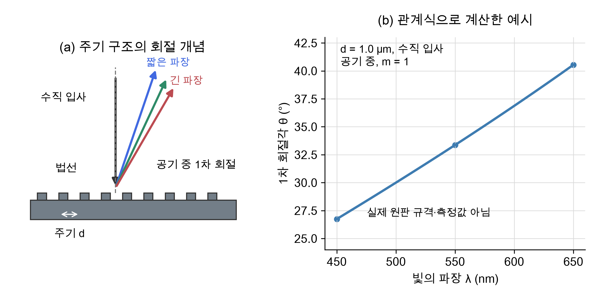

# PUA 나노패턴 제작 실습 보고서

## 목차

- 1. 서론
- 1.1 실습 목적
- 1.2 공정 개요와 평가 범위
- 2. 재료와 공정 원리
- 2.1 사용 수지와 지지 필름
- 2.2 UV 광중합과 가교 형성
- 2.3 조사 세기와 조사량
- 2.4 원판 형상의 복제와 탈형
- 2.5 건조기와 UV 경화기의 역할
- 2.6 소개된 다른 고분자와의 구분
- 3. 실험 방법
- 3.1 전체 제작 순서
- 3.2 PET 절단과 세척 및 건조
- 3.3 311RM 수지 도포
- 3.4 롤러를 이용한 밀착과 기포 제거
- 3.5 UV 조사와 경화
- 3.6 탈형과 시편 라벨링
- 3.7 작업 중 주의사항
- 4. 결과
- 4.1 재료 확인과 기록
- 4.2 장비 표시값
- 4.3 탈형과 외관 관찰
- 5. 고찰
- 5.1 접촉 상태와 결함 발생 가능성
- 5.2 경화 조건과 최적화 시간의 해석
- 5.3 탈형성과 수지의 기계적 특성
- 5.4 색 반사와 회절의 관계
- 5.5 실습 결과의 한계와 보완 방법
- 5.6 생체역학적 관점에서의 의미
- 6. 결론
- 7. 참고문헌

## 1. 서론

### 1.1 실습 목적

이번 실습의 목적은 MINS-311RM 폴리우레탄 아크릴레이트(PUA) 수지와 PET 필름을 이용하여 원판의 표면 패턴을 복제하고, 각 제작 단계가 시편의 형상 유지에 미치는 영향을 이해하는 것이다. 절단과 세척, 수지 도포, 밀착, UV 경화, 탈형을 하나의 연속 공정으로 살펴보았다. 특히 수지와 원판의 접촉 상태를 확보하는 과정과 빛으로 수지의 형상을 고정하는 과정의 역할을 구분하였다.

### 1.2 공정 개요와 평가 범위

기존 패턴을 가진 원판에 액상 수지를 도포하고 PET 필름을 밀착시킨 상태에서 UV로 경화하였다. PET는 얇은 수지층을 지지하고 탈형 후 시편을 취급하는 데 사용하였다. 이번 실습에서는 PET 위에 원판과 상보적인 표면 구조를 가진 수지층을 형성하는 것을 목표로 하였다. 제작 과정과 시편의 외관을 중심으로 관찰하였으며, 나노구조의 치수와 복제 정확도는 별도의 표면 측정이 필요한 평가 항목이다.

## 2. 재료와 공정 원리

### 2.1 사용 수지와 지지 필름

실제 제작에 사용한 수지는 MINS-311RM이다. 문헌에서는 301RM을 soft PUA, 311RM을 hard PUA로 구분하며, 이는 경화 후 재료의 상대적인 기계적 특성을 나타낸다 [1]. 이번 실습에서는 311RM의 제작 공정과 시편 외관을 관찰하였으며, 탄성계수와 파단강도는 측정하지 않았다. 얇은 수지층과 PET 지지층으로 이루어진 필름은 전체적으로 휘어질 수 있으므로, 필름의 휘어짐만으로 수지 등급을 판단하기는 어렵다.

표 2-1 제작에 사용한 재료와 역할

| 재료 또는 도구 | 역할 | 실습에서의 확인 내용 |
| --- | --- | --- |
| MINS-311RM | UV 경화 후 패턴을 유지하는 수지층 | 실제 사용 등급 311 확인 |
| PET 필름 | 수지층 지지와 시편 취급 | 투명 필름 절단과 밀착 |
| 패턴 원판 | 복제할 표면 형상의 기준 | 반원형 원판 사용·가장자리 기존 파손 |
| 에탄올과 건조 장치 | 세척 후 잔류액 제거 | 에탄올 세척 후 건조 수행 |
| 롤러와 UV 경화기 | 접촉 확보와 수지 광경화 | 롤러 밀착과 UV 조사 수행 |

패턴을 형성하는 층은 UV로 경화되는 PUA이며, PET는 경화층을 지지하는 기재이다. 원판의 재질과 표면 처리 조건은 공정 재현과 탈형성 평가를 위해 추가로 확인할 항목이다.

### 2.2 UV 광중합과 가교 형성

#### 2.2.1 개시와 사슬 성장

아크릴레이트계 광중합은 광개시제가 적절한 파장의 빛을 흡수하여 반응성 라디칼을 생성하는 개시 단계에서 시작된다. 라디칼은 아크릴레이트 반응기의 탄소 이중결합과 반응하고, 이어지는 반응기를 연결하여 고분자 사슬을 성장시킨다. 여러 반응기를 가진 성분이 연결되면 가교망이 형성되어 액상 수지의 유동성이 감소하고 형상이 고정된다 [2]. 그림 2-1(a)는 이 반응의 기능적 단계를 단순화한 개념도이다.

#### 2.2.2 건조와 경화의 구분

건조는 세척에 사용한 액체 등을 제거하는 과정이고, 광경화는 빛에 의한 화학 반응으로 수지의 가교 구조를 만드는 과정이다. 따라서 필름이나 작업 재료를 건조하는 온도는 PUA의 광경화 조건과 구분하여 기록한다.

### 2.3 조사 세기와 조사량

조사 세기 E는 단위 면적에 단위 시간 동안 도달하는 광에너지이고, 조사량 H는 E를 시간에 대해 적분한 값이다. E가 일정한 값 E₀이면 H는 E₀와 시간 t의 곱이 된다 [3].

$$H = \int_0^t E(\tau)\,d\tau$$

$$H=E_0t$$

E를 mW/cm², t를 s로 표현하면 H의 단위는 mJ/cm²가 된다. 조사 세기는 실제 시편 위치에서 측정해야 한다. 그림 2-1(b)는 일정한 조사 세기에서 시간에 비례하여 조사량이 증가하는 관계를 상대값으로 나타낸 계산 그래프이다.

그림 2-1 광중합 단계와 일정한 조사 세기에서의 조사량 관계

같은 시간 동안 조사해도 파장, 시편 위치와 필름의 광 투과 조건에 따라 수지에 도달하는 에너지가 달라진다. 같은 조사량이 같은 경화도를 보장하지도 않으므로 [3], 파장, 조사 세기, 시간과 수지층 상태를 함께 기록해야 한다.

### 2.4 원판 형상의 복제와 탈형

패턴 복제는 원판의 표면 구조를 수지와 접촉시킨 뒤 그 접촉면의 형상을 고정하는 과정이다. 수지가 원판의 오목한 부분에 접촉하면, 분리된 수지의 접촉면에는 그에 대응하는 돌출 구조가 만들어지는 것을 목표로 한다. 반대로 원판의 돌출부는 복제면에서 오목한 구조에 대응한다. 이처럼 한 번의 복제에서는 원판과 복제면의 형상이 상보적인 관계를 갖는다 [1].

그림 2-2 수지 도포부터 탈형까지의 단면 개념도

그림 2-2는 도포, PET 접촉, 접촉 상태에서의 UV 조사, 분리라는 네 단계를 나타낸다. 단면에 그린 규칙적인 요철은 원리를 설명하기 위한 가상 형상이며, 실제 원판의 주기, 높이 또는 단면을 측정한 그림은 아니다. PET를 덮는 단계에서는 수지가 표면 구조에 닿고 공기가 빠져나갈 수 있도록 접촉을 형성하는 것이 중요하다.

경화 후 분리에서는 PET와 PUA 사이의 결합이 시편을 지지하는 동안 PUA와 원판 사이의 접촉이 해제되어야 한다. 따라서 UV 경화만 완료되었다고 해서 탈형이 항상 성공하는 것은 아니다. 원판의 표면 상태, 수지층의 두께와 경화 상태, 분리 중 가해지는 힘을 함께 고려해야 한다.

### 2.5 건조기와 UV 경화기의 역할

Air Dry Oven은 설정한 온도에서 재료를 건조하는 장치이다. 일반적으로 SV는 설정값, PV는 장비 센서의 현재값을 뜻한다. 실습 중 장비의 표시부에서 SV 90°C와 PV 92°C를 확인하였다. 이 값은 장비 센서의 표시이므로 시편의 실제 온도나 건조 시간을 뜻하지 않는다. 건조 조건을 재현하려면 건조 대상과 투입·회수 시간을 별도로 기록해야 한다.

UV 경화기는 광원을 이용하여 광경화 수지에 빛을 조사하는 장치이다. 실습에 사용한 장비에는 U.V-A CURING CHAMBER와 TIME CONTROL 표시가 있었다. 시편을 챔버 안에 배치하고 밀착된 상태에서 UV를 조사하였다. 광원의 파장과 시편 위치의 조사 세기는 장비 사양과 측정값을 통해 확인해야 한다.

### 2.6 소개된 다른 고분자와의 구분

실습 중 실리콘 엘라스토머 A·B 제품, 301RM·311RM 수지와 PCL 및 PLGA로 표시된 고분자 시편을 살펴보았다. 301RM과 311RM은 PUA 수지의 등급이며, PCL과 PLGA는 별도의 고분자 재료이다. 재료의 명칭, 공급 형태와 경화 후 특성을 구분하여 이해하는 것이 중요하다.

(a) 실리콘 엘라스토머 A·B 용기     (b) 별도로 소개된 고분자 시편

그림 2-3 제작 수지와 구분되는 소개 재료

PDMS(polydimethylsiloxane, 폴리디메틸실록산)는 실리콘 계열 고분자이다. 실습에서는 실리콘 베이스와 경화제가 함께 제공되는 2성분 제품을 소개받았다. 대표적인 상용 제품인 SYLGARD 184는 베이스와 경화제를 무게비 10:1로 혼합한다 [5]. 혼합물을 틀에 부어 가교시키면 탄성체가 형성되며, 경화 후에는 가열하여 다시 녹여 성형하는 열가소성 고분자와 다른 거동을 보인다. 경화된 PDMS는 패턴 복제용 몰드로 활용할 수 있다 [1]. SYLGARD 184의 혼합비는 제품의 예시이며, 이번에 소개받은 실리콘 A·B 제품의 혼합비를 의미하지 않는다.

경화된 몰드는 상태가 유지되는 범위에서 반복 사용할 수 있다. 반복 사용 시에는 오염, 찢어짐과 표면 구조의 손상을 점검하고, 세척 및 보관 조건을 관리해야 한다. 따라서 재사용 가능성은 몰드의 상태와 복제 품질을 기준으로 판단하는 것이 적절하다.

PCL(polycaprolactone)과 PLGA(poly(lactic-co-glycolic acid))는 생분해성 폴리에스터 계열 고분자로, 조직공학용 지지체 재료로 연구된다 [6]. 이들은 광경화되는 PUA와 구분되며, 용액을 이용한 성형과 용매 제거 등으로 가공할 수 있다. 인용 연구에서는 PCL과 PLGA 및 두 재료의 혼합물을 전기방사와 용매 주조로 제작하였고, 조성과 제작 방식에 따라 강성·다공성·젖음성이 달라졌다. 따라서 재료의 이름만으로 시편의 단단함이나 세포 부착 특성을 단정하기보다 조성과 제작 조건을 함께 고려해야 한다.

## 3. 실험 방법

### 3.1 전체 제작 순서

PET 필름 준비, 세척과 건조, MINS-311RM 수지 도포, 롤러 밀착, UV 경화, 탈형과 라벨링의 순서로 제작을 진행하였다. 그림 3-1에는 각 단계의 목적과 함께 관리할 조건을 정리하였다. 제작 조건을 시편 번호와 연결하여 기록하면 이후 외관과 패턴 상태를 비교하기 쉽다.

그림 3-1 PUA 패턴 복제의 전체 공정과 기록 항목

### 3.2 PET 절단과 세척 및 건조

먼저 원판의 작업 영역을 덮을 수 있도록 PET 필름을 준비하였다. 필름에 빛을 비추어 흠집과 먼지가 없는 부분을 확인한 뒤 해당 부분을 가위로 절단하였다. 필름을 지지한 상태에서 가장자리를 정리하고, 원판 위에 놓았을 때 접히거나 들뜨지 않도록 준비하였다. 나노패턴이 있는 원판을 취급할 때에는 장갑을 착용하고 가장자리를 잡아 패턴면의 직접 접촉에 따른 오염과 손상을 줄이는 것이 중요하다.

(a) PET 필름 절단 장면     (b) 작업 영역이 보이는 원판

그림 3-2 PET 절단과 복제에 사용한 원판

그림 3-3 빛을 비추어 PET 필름의 표면 상태를 확인하는 과정

에탄올로 먼지와 이물질을 제거한 뒤 건조하였다. 세척과 건조는 수지가 접촉할 면의 오염과 잔류액을 줄여 균일한 밀착을 확보하기 위한 과정이다. 세척제는 원판의 재질과 표면 처리에 적합한 것을 사용해야 하며, 건조 후에는 남은 액체와 오염을 확인하는 것이 중요하다.

작업대에는 A4 용지를 깔고 그 위에 원판을 놓았다. 원판 바깥으로 흘러나온 수지가 경화되면서 작업대에 직접 부착되는 것을 줄이기 위해 종이를 받침으로 사용하였다. 원판의 패턴면과 수지의 접촉은 유지하였으며, 작업대 받침과 원판 표면의 이형 처리는 목적이 서로 다르다.

### 3.3 311RM 수지 도포

파이펫으로 MINS-311RM 수지를 취하여 준비한 원판 위에 떨어뜨린 뒤 PET 필름을 접촉시켰다(그림 3-4). 수지가 원판과 PET 사이에서 펼쳐지도록 하여 연속적인 층을 형성하고자 하였다. 도포량이 너무 적으면 일부 영역에 수지가 부족할 수 있고, 너무 많으면 가장자리로 흘러나오거나 두께가 불균일해질 수 있다. 반복 제작 시에는 도포 위치와 사용량을 함께 기록할 필요가 있다.

도포량과 도포 횟수는 수지층의 두께와 균일성에 영향을 줄 수 있다. 이번 실습에서는 파이펫을 사용하였으나 분주량을 수치로 기록하지 않아 총 도포량을 산출하지 않았다. 반복 제작 시에는 분주량과 도포 횟수를 함께 기록하여 시편 간 차이를 비교할 필요가 있다.

그림 3-4 파이펫을 이용한 수지 취출(왼쪽)과 원판 위 도포(오른쪽)

### 3.4 롤러를 이용한 밀착과 기포 제거

#### 3.4.1 수지층의 분포와 접촉 형성

PET 필름을 원판 위에 놓고 롤러로 밀어 수지를 펼치면서 기포를 제거하였다. 롤러는 필름과 원판의 접촉을 확보하고 두 표면 사이에 갇힌 공기를 줄이는 역할을 한다. 국부적인 기포나 이물질은 균일한 밀착을 방해할 수 있으므로, 밀착 상태를 확인하는 것이 중요하다.

다만 실습 전부터 원판 가장자리 일부가 파손되어 있어, 수지를 도포하고 롤러로 밀착시키는 과정에서 해당 부위의 기포를 완전히 제거하기 어려웠다. 원판 상태에 따라 기포 제거의 난이도가 달라질 수 있음을 실습 과정에서 경험하였다.

(a) 원판 위 필름의 롤러 밀착     (b) 종이를 받침으로 사용하는 설명 장면

그림 3-5 롤러 밀착과 작업대 받침 구성

#### 3.4.2 힘과 진행 방향의 관리

일반적인 밀착 원칙은 공기가 빠져나갈 경로를 확보하고 급격한 압력 변화를 줄이는 것이다. 필름을 천천히 접촉시키고 일정한 방향으로 롤러를 진행하면 공기가 출구 쪽으로 이동할 수 있다. 반면 과도한 힘은 수지를 밖으로 밀어내거나 원판과 필름에 손상을 줄 수 있다. 이번 실습에서는 롤러 압력과 이동 속도를 정량적으로 기록하지 않았다.

### 3.5 UV 조사와 경화

수지와 PET 필름이 원판에 밀착된 상태를 유지하여 UV 경화기에 넣고 빛을 조사하였다. 이동 중에는 원판을 수평으로 지지하여 필름이 들뜨거나 밀착 상태가 흐트러지지 않도록 하였다. 밀착이 해제되면 계면에 공기가 유입될 수 있으므로 챔버에 넣은 뒤에도 필름의 위치와 접촉 상태를 확인하는 것이 중요하다. UV 조사로 원판과 접촉한 수지의 형상을 고정한 뒤 탈형을 진행하였다.

UV 경화기의 타이머에서는 40.0을 확인하였다. 이 값의 시간 단위와 동작 모드는 확인하지 않아 실제 조사 시간으로 환산하지 않았다. 문헌에는 MINS-311RM을 PET 필름 너머로 365 nm UV에 30초 조사한 사례가 있다 [7]. 이는 문헌의 장비와 시편 조건에 따른 사례이며, 이번 실습의 조사 조건을 뜻하지 않는다. 조사 조건을 재현하려면 광원, 시편 위치, 조사 세기와 실제 시간을 함께 기록해야 한다.

### 3.6 탈형과 시편 라벨링

UV 경화 후 PET 필름을 원판에서 들어 올려 분리하였다(그림 3-6). 탈형할 때에는 가장자리에서부터 서서히 분리하여 수지층과 표면 구조에 가해지는 급격한 힘을 줄이는 것이 중요하다. 분리한 시편은 약 24시간 동안 안정화하였다. 문헌에서도 MINS-311RM으로 제작한 패턴 시편을 탈형 후 24시간 안정화한 사례가 있다 [8]. 이 안정화 단계는 추가 UV 조사와 구분하였다. 원판에 남은 수지와 시편의 찢어짐 또는 균열을 확인하여 탈형 상태를 평가할 필요가 있다.

(a) 원판에서 필름을 들어 올리는 장면     (b) 분리 후 펜으로 표시하는 장면

그림 3-6 탈형과 시편 표시

분리한 시편은 서로 구분할 수 있도록 펜으로 표시하였다. 시편 번호, 사용 수지, 제작 날짜와 주요 조사 조건을 함께 기록하면 제작 조건과 관찰 결과를 연결하여 비교할 수 있다. 표시는 패턴 관찰 영역을 피하고, 실험 기록과 동일한 시편 번호로 관리하는 것이 적절하다.

### 3.7 작업 중 주의사항

UV 조사 시에는 챔버를 닫고 장비의 차광 상태를 유지해야 한다. 수지는 필요한 양을 취한 뒤 용기를 밀폐하여 불필요한 빛 노출과 오염을 줄인다. 미경화 수지와 에탄올은 해당 제품의 안전자료 및 실험실 지침에 따라 취급한다. 광경화 수지는 반응을 일으킬 수 있는 빛에 노출되면 의도하지 않은 경화가 진행될 수 있으므로 보관 중 광 노출을 관리해야 한다.

## 4. 결과

### 4.1 재료 확인과 기록

이번 실습에서는 MINS-311RM 수지를 사용하였으며, 수지 용기의 라벨을 통해 제품명과 등급을 확인하였다(그림 4-1). PET 필름을 절단한 뒤 원판 위에서 롤러로 밀착시키고, UV 경화 후 필름을 분리하여 시편을 표시하는 과정을 수행하였다. 재료와 주요 공정에 대한 관찰 결과는 표 4-1에 정리하였다.

(a) MINS-311RM 라벨의 근접 사진     (b) 301RM과 311RM 용기의 소개 장면

그림 4-1 사용 수지와 함께 소개된 수지 등급

표 4-1 재료와 공정에 대한 관찰 결과

| 항목 | 관찰 또는 확인 결과 | 비고 |
| --- | --- | --- |
| 사용 수지 | MINS-311RM | 사용 등급 확인 |
| PET 준비 | 가위로 투명 필름 절단 | 필름 절단 수행 |
| 원판 | 반원형 원판의 가장자리 일부 파손 | 실습 전부터 파손된 상태 |
| 밀착 | 롤러로 수지를 펼치며 기포 제거 | 파손된 가장자리의 기포 제거 어려움 |
| 분리 | 필름을 원판에서 들어 올림 | 전체 복제면 손상 미평가 |
| 라벨링 | 시편 주변에 펜으로 표시 | 시편 구분을 위한 표시 |

실습에서는 제작 공정과 시편의 외관을 중심으로 결과를 관찰하였다. 수지 도포량, PET 두께와 원판의 패턴 치수에 대한 정량 기록이 부족하여 공정 조건과 복제 품질의 관계를 구체적으로 평가하는 데에는 한계가 있었다. 향후 제작 조건을 수치로 기록하고 표면 형상과 물성을 측정하면 패턴 복제의 정확도와 재현성을 평가할 수 있을 것이다.

### 4.2 장비 표시값

실습 중 확인한 건조기와 UV 경화기의 표시값을 표 4-2에 정리하였다. 건조기에는 설정값(SV) 90°C와 현재값(PV) 92°C가 표시되었고, UV 경화기의 타이머 표시값은 40.0이었다. 건조기의 표시값은 장비 센서의 값이며, 시편 온도는 별도로 측정하지 않았다.

표 4-2 촬영 당시 장비 표시값

| 장비 | 장비 표시값 | 추가로 관리할 조건 |
| --- | --- | --- |
| Air Dry Oven | Temp SV 90°C / Temp PV 92°C | 건조 대상·시간·시편 온도 |
| UV-A Curing Chamber | TIME CONTROL 40.0 | 단위·모드·실제 조사 시간 |
| UV 광원 | 램프 1·2 조작부 | 실제 파장·시편 위치의 조사 세기 |

(a) 건조기의 설정값과 현재 표시값     (b) UV 경화기의 타이머 표시부

그림 4-2 장비의 촬영 당시 상태

시편 위치의 조사 세기를 측정하지 않았고 실제 조사 시간도 충분히 기록하지 않아, 이번 실습의 UV 조사량을 산출하기 어려웠다. 공정을 재현하려면 광원 사양과 실제 측정값을 함께 기록해야 한다. 문헌의 조건을 적용할 때에는 사용 수지와 장비 조건의 차이도 검토할 필요가 있다.

### 4.3 탈형과 외관 관찰

UV 경화 후 투명 필름을 원판에서 들어 올려 분리하였다. 롤러 밀착 과정에서는 실습 전부터 파손되어 있던 원판 가장자리 부위의 기포를 완전히 제거하기 어려웠다. 이 경험을 통해 원판의 표면 상태와 가장자리의 지지 상태도 밀착 과정에서 고려해야 함을 알 수 있었다. 가장자리 부위의 패턴 손상이나 복제 정확도는 별도로 측정하지 않았다.

실습 중 살펴본 별도의 패턴 필름에서는 사각 영역에 여러 색의 반사가 나타났으며, 800 nm로 보이는 손글씨도 확인하였다. 이 필름이 이번에 제작한 시편과 동일한지, 표기가 주기·폭·높이 중 어느 치수를 뜻하는지는 확인하지 못하였다. 따라서 색 반사는 패턴 필름의 광학적 특징을 이해하는 참고 관찰로 정리하였다. 제작 시편의 나노구조 규격과 복제 품질은 원판 사양 및 SEM·AFM 측정으로 평가할 필요가 있다.

## 5. 고찰

### 5.1 접촉 상태와 결함 발생 가능성

패턴을 균일하게 복제하려면 경화 전에 수지가 원판 표면과 충분히 접촉해야 한다. 이번 실습에서는 원판 가장자리가 이미 파손되어 있어 해당 부위의 기포를 완전히 제거하기 어려웠다. 파손 부위에서는 접촉면이 불연속적이거나 필름의 지지가 불균일해질 수 있으므로, 이러한 상태가 밀착을 방해했을 가능성이 있다. 다만 원판 파손의 영향을 별도로 비교하거나 측정하지 않아 복제 품질에 미친 영향을 정량적으로 판단하기는 어렵다. 그림 5-1은 기포와 이물질이 접촉을 방해하는 원리를 설명하는 개념도이다.

그림 5-1 접촉 상태에 따른 국부적 복제 결함의 가능성

기포는 수지와 원판 사이에 빈 영역을 만들어 표면 구조가 수지에 전달되는 것을 방해할 수 있다. 먼지는 원판과 필름 사이의 간격을 국부적으로 바꾸거나 수지 표면에 이물 흔적을 남길 수 있다. 수지의 양과 점도, 필름의 접촉 순서와 롤러 취급은 이러한 결함 가능성을 함께 좌우하는 공정 변수이다.

표 5-1 예상 가능한 외관 문제와 점검 항목

| 예상 가능한 문제 | 가능한 공정 원인 | 확인을 위해 필요한 기록 |
| --- | --- | --- |
| 기포 또는 국부적 들뜸 | 공기 포획·수지 부족·원판 파손 | 경화 전 밀착면 사진 |
| 가장자리의 두꺼운 수지 | 도포량 과다·분포 불균일 | 사용량·도포 위치 |
| 시편 또는 원판의 잔류물 | 접촉 해제 실패·경화 상태 차이 | 탈형 전후 동일 영역 사진 |
| 찢어짐 또는 균열 | 급격한 분리 힘·국부적 응력 | 탈형 영상·손상 위치 |

이번 경험을 바탕으로 반복 제작 전에는 원판 가장자리의 파손과 표면 오염을 먼저 점검할 필요가 있다고 생각하였다. 파손 부위를 무리하게 눌러 밀착시키기보다는 온전한 영역을 작업 범위로 정하거나 상태가 양호한 원판을 사용하는 것이 적절하다. 롤러 취급 조건의 영향을 비교할 때에는 수지 종류, 도포량과 UV 조사 조건뿐 아니라 원판 상태도 일정하게 유지해야 한다. 경화 전 기포의 위치와 탈형 후 같은 영역의 외관을 함께 기록하면 밀착 상태와 복제 품질의 관계를 평가하는 데 도움이 될 것이다.

### 5.2 경화 조건과 최적화 시간의 해석

경화 조건은 액상 수지의 형상을 고정하고 탈형 중에도 구조가 유지되도록 정해야 한다. 조사량의 증가만을 기준으로 최적 조건을 판단하기보다는 수지의 광 반응 특성, 층의 두께와 시편에 도달하는 빛을 함께 검토해야 한다. 광중합에서 발생할 수 있는 산소에 의한 반응 저해와 중합 수축도 고려할 변수이다 [2, 3]. 이번 실습에서는 경화도와 수축률을 별도로 측정하지 않았다.

최적 경화 조건을 정하려면 나머지 조건을 일정하게 유지하고 조사 시간을 달리하여 경화 상태, 탈형 상태와 패턴 형상을 비교해야 한다. 실제 UV 조사 시간과 조사 후 안정화 시간은 각각 기록하여 구분하는 것이 중요하다. 이번 실습에서 적용한 약 24시간 안정화 과정도 조사량을 계산하는 UV 조사 시간에 포함하지 않는다.

### 5.3 탈형성과 수지의 기계적 특성

탈형 과정에서는 원판과 수지의 접촉을 해제하는 힘이 수지층과 PET에 전달된다. 얇은 필름은 전체적으로 휘어질 수 있으나, 표면의 작은 구조에는 국부적인 응력이 작용할 수 있다. 이번 실습에서 필름을 원판으로부터 분리하였지만, 필름 분리만으로 나노패턴 전체의 형상 보존 여부를 판단하기는 어렵다. 특히 기존에 파손된 원판 가장자리와 대응하는 시편 영역은 탈형 후 미세 손상을 추가로 확인할 필요가 있다.

301RM과 311RM의 soft·hard 구분은 재료 선택을 이해하는 기준이다. 수지 등급이 탈형성에 미치는 영향을 평가하려면 같은 원판과 제작 조건에서 두 수지를 비교하고, 복제 구조와 기계적 응답을 측정해야 한다. 이번 실습에서는 311RM을 사용하였으므로 등급 간 우열을 판단하기 어렵다. 비교 실험에서는 원판의 표면 상태와 분리 방법도 일정하게 유지해야 한다.

### 5.4 색 반사와 회절의 관계

규칙적인 표면 구조는 파장과 관찰 방향에 따라 서로 다른 방향으로 빛을 회절시킬 수 있다 [4]. 실습 중 살펴본 패턴 필름의 색 반사를 이러한 원리와 연결하여 이해할 수 있었다. 다만 반사색에는 조명, 촬영 각도와 다른 광학 효과도 영향을 줄 수 있으므로 색만으로 패턴 치수나 복제 품질을 확정하기는 어렵다.

그림 5-2 주기 구조의 회절 개념과 가상 주기에서의 계산 예시

그림 5-2는 공기 중에서 1차원 격자에 빛이 수직으로 입사하는 이상적인 경우를 나타낸다. 이때 주기 d, 회절차수 m, 파장 λ와 회절각 θ 사이에는 다음 관계가 성립한다 [4].

$$d\sin\theta=m\lambda$$

그래프는 설명용으로 d = 1.0 µm와 m = 1을 가정하고 450–650 nm에서 회절각을 계산한 것이다. 이 값은 실제 원판의 주기가 아니다. 실제 패턴을 평가하려면 구조 방향과 치수를 확인하고 조명 및 관찰 조건도 기록해야 한다. 회절의 유무와 패턴 형상의 정확도는 서로 다른 평가 항목이다.

### 5.5 실습 결과의 한계와 보완 방법

이번 실습에서는 제작 조건을 충분히 수치로 기록하지 않았고 표면 형상도 측정하지 않아, 공정 재현성과 나노패턴의 복제 정확도를 정량적으로 평가하기 어려웠다. 또한 원판 가장자리의 기존 파손으로 기포 제거에 어려움을 겪었다. 이후에는 원판의 상태와 작업 범위를 먼저 확인하고 PET 규격, 도포량, 건조 조건, UV 파장·조사 세기·실제 시간을 함께 기록할 필요가 있다. 기포 제거 전후와 탈형 전후의 동일한 영역을 촬영하면 공정 중 발생한 변화를 비교할 수 있을 것이다.

SEM은 구조의 평면 및 기울어진 관찰상을, AFM은 표면 높이 분포를 얻는 데 사용할 수 있다. 이번 실습에서는 SEM·AFM 측정 자료가 없어 나노구조의 주기, 높이와 결함률을 정량적으로 평가하기 어려웠다. 향후에는 원판과 복제면의 대응하는 치수를 측정하고, 측정 위치와 반복 수를 정하여 복제 정확도를 비교할 필요가 있다.

### 5.6 생체역학적 관점에서의 의미

미세한 표면 구조를 가진 고분자 필름에서는 재료의 기계적 성질과 구조의 형상이 함께 접촉 거동을 결정한다. 관련 PUA 연구에서는 표면 구조와 재료 강성이 기계적 맞물림 및 접착 거동에 미치는 영향을 평가하였다 [1]. 이번 실습을 통해 접착이나 인장 특성을 평가하기에 앞서 균일한 형상의 시편을 제작하고, 밀착 상태와 원판 상태를 관리하는 것이 중요함을 이해하였다.

향후 접착이나 인장 거동을 평가하려면 패턴 면적, 시편 두께, 하중 방향과 시험 속도를 정의하고 반복 측정해야 한다. 이번 실습에서는 시편 제작을 수행하였으며 인장 특성과 접착 성능은 별도로 측정하지 않았다. 피부 부착 등 생체 관련 응용을 검토할 때에는 사용 목적에 맞는 기계적 성능과 생체적합성을 추가로 평가할 필요가 있다.

실습에서 소개받은 PCL과 PLGA는 조직공학 지지체 재료로 연구되는 생분해성 고분자이다 [6]. 이러한 재료의 표면 구조와 젖음성은 세포와의 상호작용을 평가할 때 함께 고려할 요소이다. 이번 실습에서는 세포 배양이나 생체적합성 평가를 수행하지 않았으므로, 재료의 조직공학적 활용 가능성을 이해하는 수준에서 정리하였다.

## 6. 결론

MINS-311RM 수지와 PET 필름을 이용하여 원판의 표면 형상을 복제하는 제작 공정을 수행하였다. PET 절단, 세척과 건조, 수지 도포, 롤러 밀착, UV 경화, 탈형과 시편 표시로 이어지는 각 단계의 역할을 이해하였다. 광경화는 원판과 접촉한 PUA의 형상을 가교망으로 고정하는 과정이며, PET는 경화층을 지지하고 취급을 돕는다.

롤러로 수지를 펼치고 기포를 제거하는 과정에서 원판 가장자리의 기존 파손 때문에 해당 부위를 균일하게 밀착시키기 어려웠다. 이를 통해 수지 도포량과 롤러 취급뿐 아니라 원판의 상태와 작업 범위도 제작 전에 확인해야 함을 알 수 있었다. 이번 실습에서는 제작 과정과 필름 분리를 확인하였으며, 나노구조의 치수와 복제 정확도는 정량적으로 평가하지 않았다. 향후 공정 조건을 수치로 기록하고 원판과 복제면의 표면 형상을 비교하면 제작 품질과 재현성을 평가할 수 있을 것이다.

## 7. 참고문헌

[1] Seong, M.; Park, H.-H.; Hwang, I.; Jeong, H. E. Strong and Reversible Adhesion of Interlocked 3D-Microarchitectures. Coatings, 2019, 9(1), 48. DOI: 10.3390/coatings9010048. https://www.mdpi.com/2079-6412/9/1/48

[2] Lang, M.; Hirner, S.; Wiesbrock, F.; Fuchs, P. A Review on Modeling Cure Kinetics and Mechanisms of Photopolymerization. Polymers, 2022, 14(10), 2074. DOI: 10.3390/polym14102074. https://pmc.ncbi.nlm.nih.gov/articles/PMC9145830/

[3] Opsytec Dr. Gröbel. UV Curing and Photopolymerization Fundamentals. https://www.opsytec.com/uv-applications/uv-processes/uv-curing-photopolymerization (열람 2026.10.13)

[4] MKS Newport. The Grating Equation. https://www.newport.com/n/the-grating-equation (열람 2026.10.13)

[5] MilliporeSigma. SYLGARD 184 Silicone Elastomer Kit. https://www.sigmaaldrich.com/JM/en/product/aldrich/761036 (열람 2026.10.13)

[6] Rosalia, M. et al. Investigation on Electrospun and Solvent-Casted PCL-PLGA Blends Scaffolds Embedded with Induced Pluripotent Stem Cells for Tissue Engineering. Pharmaceutics, 2023, 15(12), 2736. DOI: 10.3390/pharmaceutics15122736. https://pmc.ncbi.nlm.nih.gov/articles/PMC10747843/

[7] Jang, S. et al. 10 nm scale nanopatterning on flexible substrates by a secondary sputtering phenomenon and their applications in high performance, flexible and transparent conducting films. J. Mater. Chem. C, 2014, 2, 3527–3531. Supporting Information. DOI: 10.1039/C4TC00012A. https://www.rsc.org/suppdata/tc/c4/c4tc00012a/c4tc00012a1.pdf

[8] Matrix Topography Regulates Synaptic Transmission at the Neuromuscular Junction. Advanced Science, 2019. Experimental Section: Preparation of Nanogrooved Substrates. https://pmc.ncbi.nlm.nih.gov/articles/PMC6425454/
