# 합성 고분자 가공과 PUA 플레이트 제작

2026년 10월 8일 실습 · 5조 · 김택준, 이푸름, 이현기, 임두희

최신 제출본은 팀원 양식과 기존 보고서 내용을 통합한 Word 문서이며 표지·목차·참고문헌을 포함해 총 20쪽이다.

## 1. 서론

### 1.1 실습 목적

2026년 10월 8일 실습에서는 합성 고분자의 가공 원리를 배우고, MINS-311RM 수지와 PET 필름으로 PUA 플레이트를 제작하였다. 우리 조는 패턴이 없는 플랫(flat) 웨이퍼를 사용하였다. 따라서 직접 제작한 시편은 평탄한 PUA 필름이며, 나노패턴 시편은 수업에서 소개된 비교용 시편을 관찰하였다. 이전 실습에서 익힌 피펫과 UV 경화 챔버의 사용법을 실제 제작 과정에 적용하였다.

플레이트는 실험에 사용하는 얇은 고분자 판 또는 필름을 뜻한다. 재료에 따라 고체가 되는 원리가 다르므로 계량, 기포 제거, 성형과 분리 방법도 달라진다. 이번 실습에서는 재료별 가공 방식의 차이를 이해하고, PUA의 도포·밀착·광경화·탈형 과정을 연결해 살펴보았다. 제작 중에는 원판의 기존 파손부에서 기포를 제거하기 어려운 점을 경험하였다.

### 1.2 재료와 공정 흐름

수업에서 소개된 합성 고분자는 PDMS, PUA, PCL, PLGA였다. PDMS는 베이스와 경화제를 혼합해 가교시키며, 가열하면 경화가 빨라진다. PUA는 광개시제가 반응할 수 있는 빛을 조사해 경화한다. PCL과 PLGA는 용매 제거 또는 열가소성 성형으로 가공할 수 있다. 우리 조는 PUA를 직접 제작하고, 다른 재료는 원료와 완성 시편을 보며 원리와 성질을 비교하였다(표 1-1).

표 1-1. 실습 재료의 굳는 방식과 이번 실습에서 한 일

| 재료 | 정식 이름 | 굳는 방식 | 이번 실습 |
| --- | --- | --- | --- |
| PDMS | 폴리디메틸실록산 | 베이스·경화제 혼합 후 가교 가열로 반응 촉진 | 원료 확인, 원리 설명 |
| PUA (MINS-301RM, 311RM) | 폴리우레탄 아크릴레이트 | 광개시제가 시작하는 UV 광중합 | 311RM으로 플랫 필름 제작 |
| PCL | 폴리카프로락톤 | 용매 제거 또는 열가소성 성형 | 나노 패턴 디스크 관찰 |
| PLGA | 폴리(락트산-글리콜산) 공중합체 | 용매 제거 또는 열가소성 성형 | 나노 패턴 디스크 관찰 |

## 2. 공통 주의사항

원판을 꺼내고 수지를 취급할 때에는 장갑을 착용하였다. 특히 웨이퍼는 가장자리를 잡아 작업면에 지문이나 오염이 묻지 않도록 다룬다. 표면의 먼지와 흠집은 수지의 밀착을 방해하거나 복제면에 자국을 남길 수 있다. 얇은 웨이퍼는 충격에 취약하므로 전용 케이스에서 꺼내고 옮길 때 파손에 주의해야 한다.

PUA 수지는 필요한 양을 취한 뒤 용기를 다시 닫아 오염과 불필요한 빛 노출을 줄였다. 광경화는 뚜껑을 열거나 상온에 놓는 행위 자체가 아니라, 광개시제가 반응할 수 있는 파장의 빛에 노출될 때 일어난다. 따라서 수지의 보관 조건과 차광 지침을 확인하고, 개봉한 상태로 오래 두지 않는 것이 적절하다.

UV 경화는 챔버를 닫고 장비의 차광 조건을 유지한 상태에서 수행한다. 자외선은 눈과 피부에 손상을 줄 수 있으므로 [1] 조사 중에는 광원에 직접 노출되지 않도록 한다. 미경화 수지와 에탄올은 해당 제품의 안전자료와 실험실 지침에 따라 취급하며, 세척액이 남은 시편을 가열하거나 경화하지 않도록 건조 상태를 확인한다.

## 3. 재료별 원리

### 3.1 고분자의 분류

고분자는 반복되는 단위가 사슬 형태로 연결된 물질이며, 원료와 제조 방식에 따라 천연 고분자와 합성 고분자로 구분할 수 있다(그림 3-1 (a)). 수업에서는 콜라겐, 키토산, 알지네이트를 천연 고분자의 예로 들었다. 합성 고분자는 조성과 제조 조건을 조절해 목적에 맞는 물성을 얻을 수 있다. 이번에 다룬 PDMS와 PUA는 가교망을 형성하는 재료이고, PCL과 PLGA는 생분해성 폴리에스터이다.

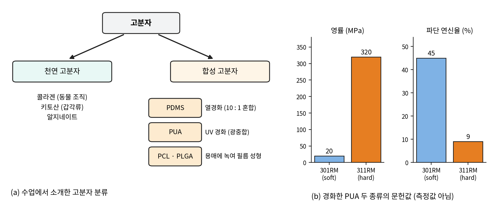
그림 3-1. 수업에서 소개한 고분자 분류와 PUA 두 종류의 문헌값

액체 또는 용액에서 고체 시편을 만드는 과정이 모두 가교 반응인 것은 아니다. PDMS와 PUA는 사슬 사이에 화학적 연결이 생겨 그물 구조를 형성한다(그림 3-2). 반면 PCL과 PLGA는 이미 합성된 고분자를 용매에 녹인 뒤 용매를 제거하거나, 가열 성형 후 냉각하여 고체로 만들 수 있다. 따라서 가교에 의한 경화와 용매 제거·냉각에 의한 고화를 구별해야 한다.

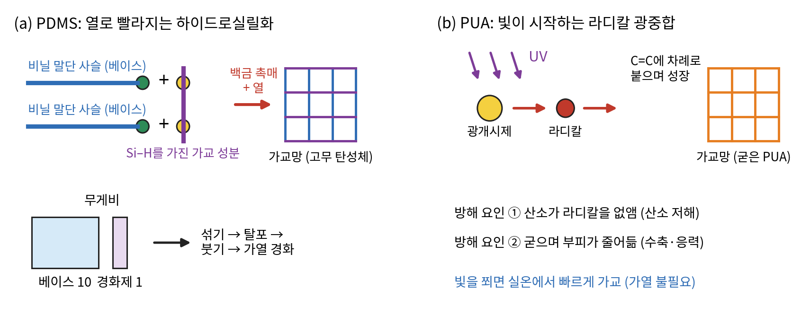
그림 3-2. PDMS의 열경화와 PUA의 광경화 (개념도)

### 3.2 PDMS

#### 3.2.1 원리

PDMS(polydimethylsiloxane, 폴리디메틸실록산)는 실리콘 계열 고분자이다. 대표적인 상용 제품인 SYLGARD 184는 베이스와 경화제를 무게비 10:1로 혼합하도록 안내한다 [2,4]. 이 계열의 제형에서는 백금 촉매에 의한 Si-H기와 비닐기의 하이드로실릴화 반응으로 가교망이 형성된다 [3](그림 3-2 (a)). 실습에서 소개받은 베이스 라벨에는 비닐 말단 실록산 성분이 표시되어 있었다(그림 3-3 (a)).

PDMS의 경화는 혼합 후 실온에서도 진행될 수 있으며, 가열하면 반응이 빨라진다. SYLGARD 184 제조사는 경화 조건의 예로 25 °C에서 48시간, 100 °C에서 35분, 150 °C에서 10분을 제시한다 [4]. 이 수치는 해당 제품의 안내 조건이며 우리 조의 실측 조건은 아니다. 한 번 가교된 PDMS는 다시 녹여 성형하는 열가소성 고분자와 달리, 탄성체 형태로 유지된다.

#### 3.2.2 구성과 제작 순서

실습에서는 Silicone Elastomer 베이스와 경화제 용기를 소개받았다(그림 3-3). 다만 소분 용기의 표기만으로 원제품을 SYLGARD 184라고 단정하지 않았다. 우리 조는 PDMS를 직접 제작하지 않았으며, 아래 순서는 대표적인 2성분 PDMS의 제작 원리를 설명하기 위한 것이다. 실제 제작 시에는 제품별 혼합비와 경화 조건을 우선 확인해야 한다.

1. 제품의 지정 비율로 베이스와 경화제를 질량 기준으로 계량하고 균일하게 섞는다. SYLGARD 184의 예시는 10:1이다 [4].

2. 섞은 액체를 진공 챔버에 넣어 기포를 뺀다(2회차).

3. 틀(몰드)에 붓는다.

4. 제품의 지정 조건에서 경화시킨 뒤 틀에서 분리하여 플레이트를 얻는다. 가열은 경화 시간을 줄이는 방법이다.

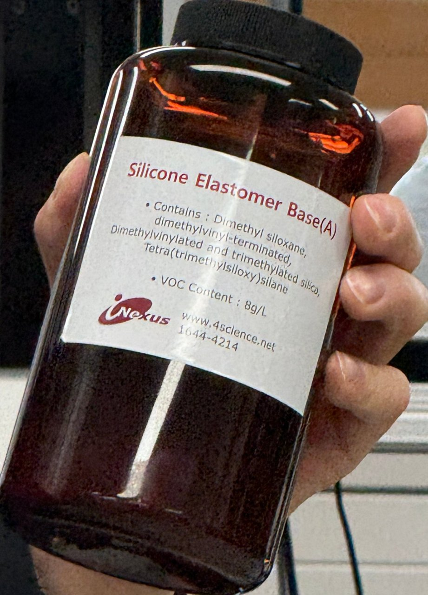
(a) 베이스(A) 라벨

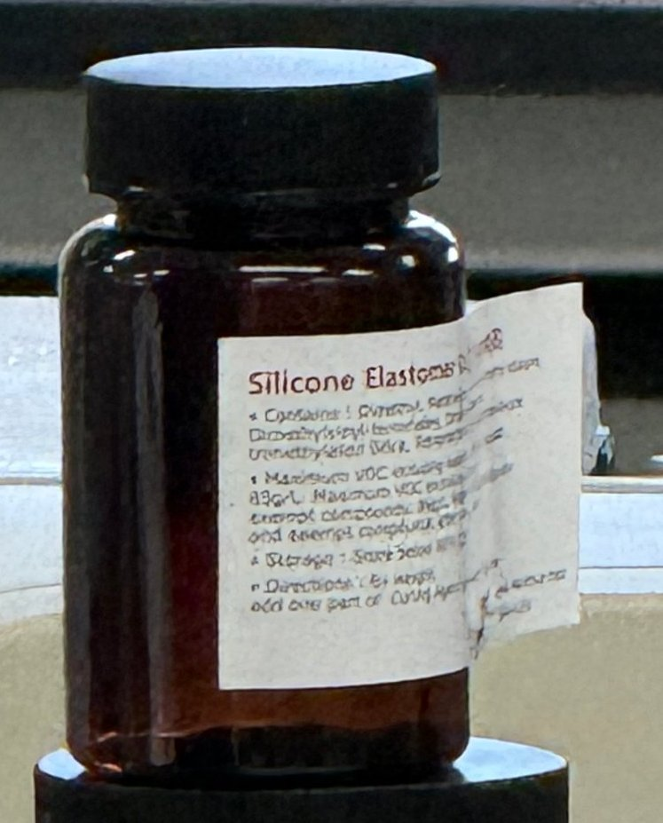
(b) 경화제로 보이는 작은 병

그림 3-3. 실습에 소개된 PDMS 원료

#### 3.2.3 주의점과 이유

혼합비를 일정하게 유지하면 가교 상태와 물성의 변화를 줄일 수 있다. 따라서 지정 비율이 질량 기준인지 부피 기준인지 확인하고, 계량과 혼합을 같은 방식으로 반복해야 한다. 특히 10:1이라는 대표 제품의 혼합비를 모든 실리콘 제품의 공통 조건이나 실험실의 최적값으로 해석해서는 안 된다.

혼합 과정에서 포획된 공기는 탈포로 줄인다. SYLGARD 184의 혼합 점도는 약 3,500 cP로 안내되어 있어 [4] 작은 기포가 쉽게 빠져나오기 어렵다. 진공에서는 기포가 팽창하고 표면으로 이동해 제거될 수 있다. 다만 점도, 시료량과 용기 깊이에 따라 제거 속도가 달라지며, 급격한 압력 변화로 혼합물이 넘치지 않도록 관찰해야 한다.

경화된 PDMS는 투명성과 탄성을 활용해 패턴 복제용 몰드로 사용할 수 있다 [5]. 실습에서는 반복 사용할 수 있는 재료로 소개받았으나, 오염·찢어짐·표면 손상이 누적되면 복제 품질이 달라질 수 있으므로 영구적인 재사용을 보장하는 것은 아니다. 또한 연구용 제품의 생체적합성은 제형과 잔류물, 세척 및 사용 목적에 따라 평가해야 하며, 일반적인 실리콘의 의료 활용을 해당 제품의 인체 적용 가능성과 동일하게 볼 수 없다.

### 3.3 PUA

#### 3.3.1 원리

PUA(polyurethane acrylate, 폴리우레탄 아크릴레이트)는 우레탄 구조와 아크릴레이트기를 갖는 광경화형 수지이다. 광개시제가 적절한 파장의 빛을 흡수하면 라디칼이 생성되고, 아크릴레이트의 탄소-탄소 이중결합에서 중합이 시작된다. 반응이 이어지며 사슬이 성장하고 가교망이 만들어져 액체 수지가 고체로 변한다 [6](그림 3-2 (b)). 빛의 조사 조건으로 반응을 제어할 수 있다는 점이 제작 공정의 핵심이다.

라디칼 광중합에서는 산소가 반응을 저해할 수 있으며, 중합 수축은 내부 응력과 변형에 영향을 줄 수 있다 [6]. PET로 덮는 과정은 수지층을 지지하고 공기 접촉을 줄이는 역할을 한다. 그러나 PET를 덮었다고 산소 저해가 완전히 사라지거나, 일정 시간 두었다고 가교가 완료되었다고 단정할 수는 없다. 경화 상태와 치수 안정성은 각각 확인해야 한다.

#### 3.3.2 제품과 성질

수업에서는 MINS-301RM을 상대적으로 부드러운 PUA, MINS-311RM을 상대적으로 단단한 PUA로 소개받았다(그림 3-4). 문헌에는 경화 후 영률이 각각 약 20 MPa와 320 MPa, 파단 연신율이 약 45%와 9%인 예가 보고되어 있다 [5](그림 3-1 (b)). 영률은 변형에 대한 저항을 나타내며 표면 경도와 같은 측정값은 아니다. 우리 조는 용기 라벨과 사용 수지를 확인하여 MINS-311RM으로 제작하였다. 두 등급의 물성을 직접 측정하거나 비교하지는 않았다.

(a) MINS-301RM과 311RM

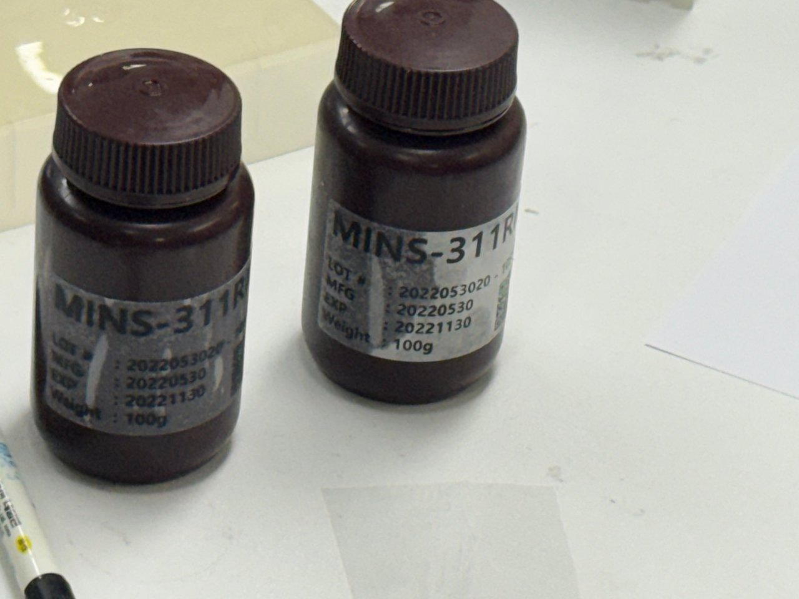
(b) 우리 조 작업대의 311RM

그림 3-4. 소개된 PUA 등급과 우리 조가 사용한 MINS-311RM

### 3.4 PCL과 PLGA

PCL(polycaprolactone)과 PLGA(poly(lactic-co-glycolic acid))는 생분해성 폴리에스터 계열 고분자로, 조직공학용 지지체에 널리 연구되어 왔다 [8]. 이들은 PUA와 달리 가공 과정에서 반드시 UV 가교를 일으킬 필요가 없다. 용매 캐스팅은 고분자 용액을 틀에 넣고 용매를 제거하는 방식이며, 열·압력에 의한 성형은 재료를 변형시킨 뒤 냉각하여 형상을 유지하는 방식이다. 사용 용매와 온도는 고분자의 조성과 가공 목적에 따라 정해야 한다.

실습에서는 PCL이 상대적으로 부드럽고 다루기 편하며, PLGA는 더 단단한 재료로 소개되었다. 이 차이는 분자량, 조성과 시편 구조에도 영향을 받으므로 모든 등급에 동일하게 적용되는 것은 아니다. PCL의 소수성은 세포 부착에 불리할 수 있어 표면 성질을 함께 고려해야 한다 [9]. 소개받은 PCL·PLGA 원형 시편에서는 각도에 따라 색이 달라지는 면을 관찰하였다(그림 3-5). 우리 조가 이 시편을 직접 제조하거나 패턴 치수를 측정한 것은 아니다.

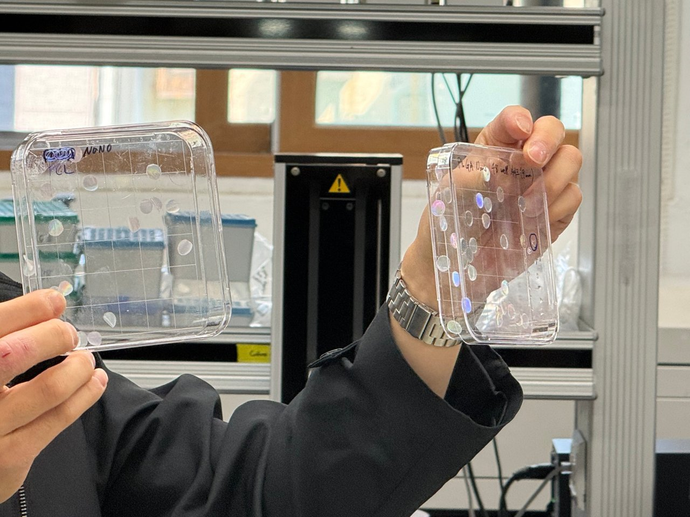
그림 3-5. PCL·PLGA 나노 패턴 디스크 (보관 상자)

## 4. PUA 플레이트 제작

PUA 플레이트는 웨이퍼 위에 수지를 도포하고 PET 필름을 밀착시킨 뒤 UV로 경화하여 얻는다. 경화된 수지층을 PET와 함께 분리하면 웨이퍼와 접촉했던 면이 드러난다. 우리 조는 플랫 웨이퍼를 사용하였으며, 그림 4-1 (a)의 패턴 단면은 나노패턴 복제 원리를 설명하는 개념도이다. 실제로 수행한 제작 흐름은 다음과 같다.

1. 원판 준비: 장갑을 착용하고 웨이퍼를 꺼낸 뒤 표면을 세척하고 충분히 건조한다.

2. 기판 준비: PET를 빛에 비추어 흠집과 먼지가 없는 부분을 고르고, 작업 영역을 덮을 수 있게 절단한다.

3. 도포: 책상에 A4 종이를 깔고 웨이퍼를 놓은 뒤 피펫으로 PUA를 여러 곳에 떨어뜨린다.

4. 밀착: PET의 깨끗한 면을 아래로 해서 덮고 롤러로 이어서 밀어 PUA를 펴고 기포를 뺀다.

5. 경화: 수지와 PET의 밀착 상태 및 수평을 유지하여 UV 챔버에 넣고 장비 조건에 따라 조사한다.

6. 탈형과 안정화: 분리 가능한 상태인지 확인하고 PET를 천천히 들어 올린 뒤 시편을 표시하고 약 24시간 안정화한다.

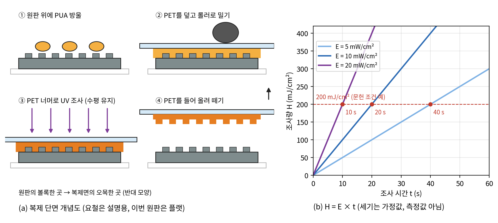
그림 4-1. PUA 복제 과정의 단면과 조사 세기에 따른 조사량 (개념도, 세기는 가정값)

### 4.1 원판과 기판 준비

우리 조는 패턴이 없는 플랫 웨이퍼를 원판으로 사용하였다. 따라서 제작 목적은 PUA 수지의 도포, PET 밀착, UV 경화와 분리 과정을 익히고 평탄한 필름을 얻는 것이었다. 나노패턴이 있는 웨이퍼와 복제 필름은 비교용으로 소개받았다. 원판을 꺼낼 때에는 장갑을 착용하고 가장자리를 지지하여 표면의 오염과 추가 손상을 줄인다.

원판의 표면을 에탄올로 세척하고 건조하였다. 세척대의 에탄올 용기와 건조 오븐을 확인했으며, 오븐 화면에는 설정 온도(SV) 90 °C와 현재 온도(PV) 92 °C가 표시되어 있었다(그림 4-3 (b)). 이 값은 촬영 시점의 장비 표시값이다. 실제 웨이퍼 온도나 건조 시간을 직접 측정한 값으로 해석하지 않았다.

PET 필름을 빛에 비추어 흠집과 먼지가 적은 부분을 고른 뒤, 웨이퍼의 작업 영역을 충분히 덮고 손으로 지지할 여유가 있도록 가위로 절단하였다. 절단 후에는 에어 블로어로 먼지를 제거하였다(그림 4-2). 접촉면에 이물이 남으면 수지의 분포와 밀착이 불균일해질 수 있으므로, 필름을 덮기 전에 표면 상태를 다시 살펴보았다.

(a) PET 자르기

(b) 에어 블로어로 먼지 불어 내기

그림 4-2. PET 필름 준비

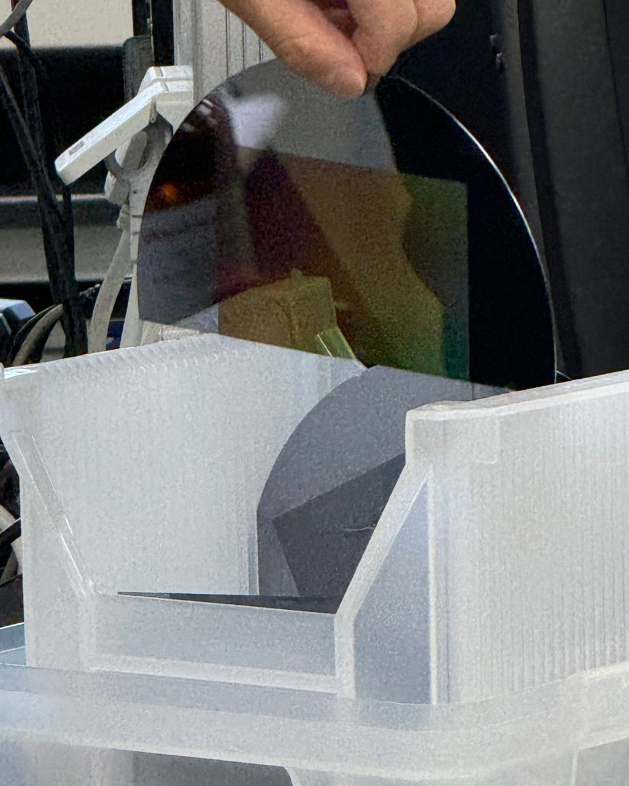
(a) 웨이퍼 보관 케이스

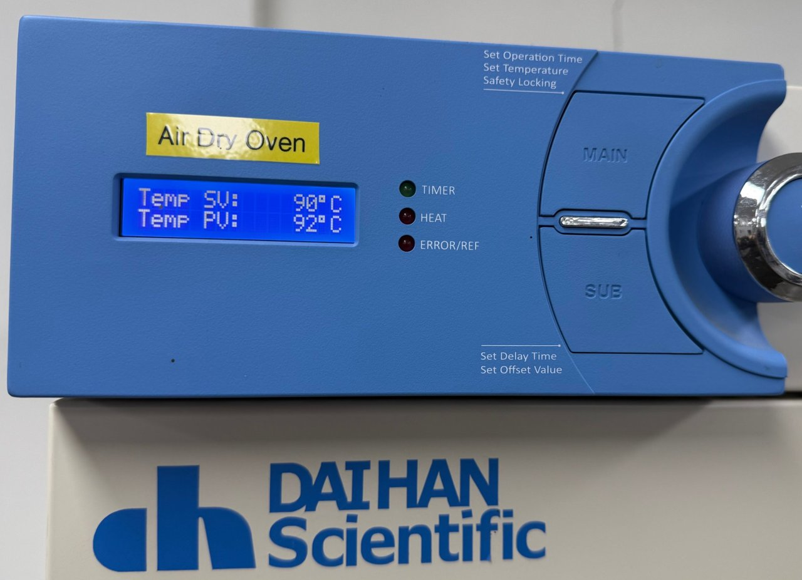
(b) 건조 오븐 (설정 90 °C)

그림 4-3. 원판 보관과 건조

### 4.2 도포와 밀착

작업대에는 A4 용지를 깔고 그 위에 웨이퍼를 놓았다. 수지가 바깥으로 퍼져 경화되면 작업대에 달라붙을 수 있으므로 종이를 받침으로 사용하였다. 이는 웨이퍼와 수지 사이의 이형 처리를 대신하는 단계는 아니다. 피펫으로 MINS-311RM을 취하여 웨이퍼 표면의 여러 위치에 나누어 떨어뜨렸다(그림 4-5). 도포량은 별도로 계량하지 않았으므로 수지의 분포와 밀착 상태를 중심으로 확인하였다.

PET의 깨끗한 면을 수지 쪽으로 덮고 롤러를 사용해 수지를 펼치면서 공기를 가장자리로 밀어냈다(그림 4-4 (a)). 밀착 상태를 빛에 비추어 기포와 들뜸을 확인하였다. 이때 원판의 가장자리 일부가 실험 전부터 깨져 있어 해당 부위는 PET가 균일하게 밀착되지 않았고 기포를 완전히 제거하기 어려웠다. 파손부에 무리한 힘을 가하면 추가 손상이 생길 수 있어, 가장자리의 남은 기포를 공정 중 확인한 문제로 구분하였다.

(a) 롤러로 펴기

(b) 떼어 낸 뒤 종이에 남은 PUA 자국

그림 4-4. 롤러 밀착과 받침 종이

(a) 피펫으로 311RM 취하기

(b) 웨이퍼 위에 떨어뜨리기

그림 4-5. PUA 도포

### 4.3 UV 경화

UV 경화 조건은 조사 세기와 조사량으로 설명할 수 있다. 조사 세기 E는 단위 면적에 도달하는 광출력이며, 조사량 H는 이를 시간에 대해 적분한 에너지이다 [10]. 조사 세기가 일정하면 H=Et가 된다. 예를 들어 10 mW/cm²로 20초 조사한 계산값은 200 mJ/cm²이다(그림 4-1 (b)). 이 수치는 원리 설명을 위한 가정값이며 실제 실습 측정값은 아니다. 같은 조사량이라도 파장, 수지층 두께와 산소 조건이 다르면 경화 결과가 달라질 수 있다.

H = ∫₀ᵗ E(τ) dτ    ;    E 일정: H = E t

수지와 PET 필름이 웨이퍼에 밀착된 상태를 유지하여 UV 경화 챔버에 넣었다. 웨이퍼 한쪽이 들리면 PET와 수지 사이로 공기가 다시 유입될 수 있으므로 수평을 유지하며 옮겼다. 챔버의 POWER와 LAMP 스위치, 디지털 타이머를 확인하고 서랍을 닫은 상태에서 조사하였다(그림 4-6). 타이머에는 40.0이 표시되어 있었으나 단위와 동작 모드는 확인하지 못해 실제 조사 시간으로 환산하지 않았다.

문헌에는 MINS-311RM을 PET 필름 너머로 365 nm UV로 약 30초 조사한 제작 예가 있다 [11]. 이 조건은 해당 연구의 광원과 제작 환경에 대한 예시이며 이번 실습의 적정 시간으로 적용할 수는 없다. 우리 조는 시편 위치의 조사 세기와 실제 노출 시간을 측정하지 않았으므로 조사량을 계산하거나 문헌과 정량 비교하지 않았다. 반복 제작에서는 조사 시작·종료 시점과 광원 조건을 함께 확인하는 것이 필요하다.

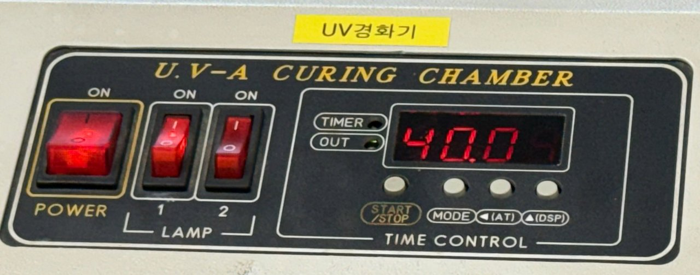
(a) 챔버 패널과 타이머

(b) 서랍 안의 시편

그림 4-6. UV-A 경화 챔버

### 4.4 탈형과 시편 안정화

UV 조사 후에는 수지층이 분리 가능한 상태인지 확인하고, PET를 가장자리에서 천천히 들어 올려 웨이퍼와 분리하였다(그림 4-7 (a)). 수지층은 PET에 지지된 상태로 분리되었으며, 우리 조의 플랫 웨이퍼에서는 평탄한 접촉면을 얻었다. 패턴 원판을 사용할 경우에는 원판의 요철과 상보적인 구조가 복제되는 것이 원리이다 [11,12]. 이번 직접 제작 결과와 패턴 복제의 원리를 구별하였다.

분리한 시편은 조와 시편의 방향을 구분할 수 있도록 표시하였다(그림 4-7 (b)). 탈형 후에는 시편을 약 24시간 안정화하도록 하였다. 이는 분리 직후의 취급과 변형을 줄이기 위한 단계이며, 추가 UV 조사나 완전한 가교를 확인했다는 의미는 아니다. 문헌에도 탈형 후 24시간 안정화하는 예가 있다 [15]. 안정화 전후에는 시편을 불필요하게 접거나 잡아당기지 않고, 오염과 변형이 생기지 않도록 지지하여 보관하는 것이 적절하다.

(a) PET를 한쪽 끝부터 떼어 내기

(b) 마커로 표시하기

그림 4-7. PET 떼어 내기와 표시

### 4.5 비교용 나노패턴과 무지개색

수업에서 소개된 패턴 웨이퍼와 패턴 필름, PCL·PLGA 시편은 보는 각도에 따라 색이 달라졌다. 주기적으로 반복된 표면 구조는 회절격자처럼 빛의 진행 방향을 바꿀 수 있다. 공기 중에서 빛이 수직 입사하는 단순한 격자 모형에서는 d sin θ=mλ의 관계를 사용한다 [13]. d는 반복 간격, θ는 법선에 대한 회절각, m은 회절 차수, λ는 파장이다. 파장마다 방향이 달라 백색광의 색이 갈라져 보일 수 있다(그림 4-8 (a)).

d sin θ = m λ    ;    수직 입사, 공기 중 격자 모형

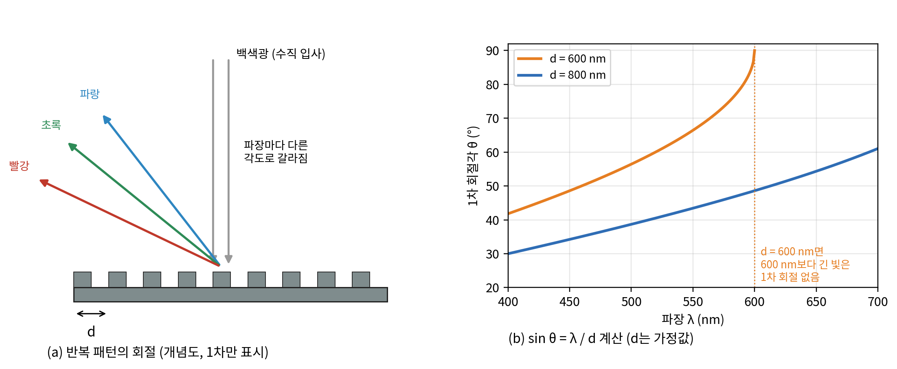
그림 4-8. 반복 패턴의 회절과 패턴 간격에 따른 1차 회절각 (계산값, 간격은 가정값)

그림 4-8 (b)는 반복 간격을 600 nm와 800 nm로 가정하여 1차 회절각을 계산한 예이다. 600 nm 간격에서는 400 nm와 500 nm 빛의 회절각이 각각 약 42°와 56°이며, 600 nm보다 긴 파장에는 이 단순 모형의 전파하는 1차 회절이 없다. 800 nm 간격에서는 700 nm 빛의 회절각이 약 61°이다. 이 계산은 관찰한 필름의 실제 치수를 역산한 결과가 아니다. 색 변화만으로 선폭이나 높이, 복제 정확도를 판단할 수는 없다.

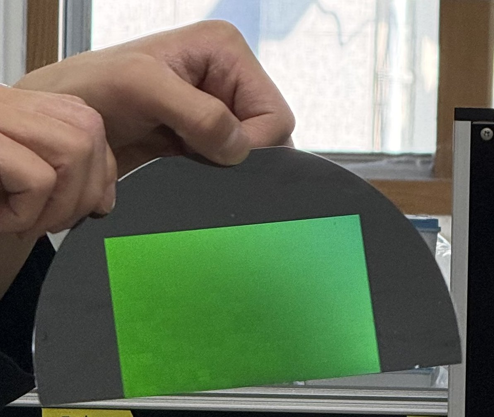
(a) 패턴이 새겨진 웨이퍼

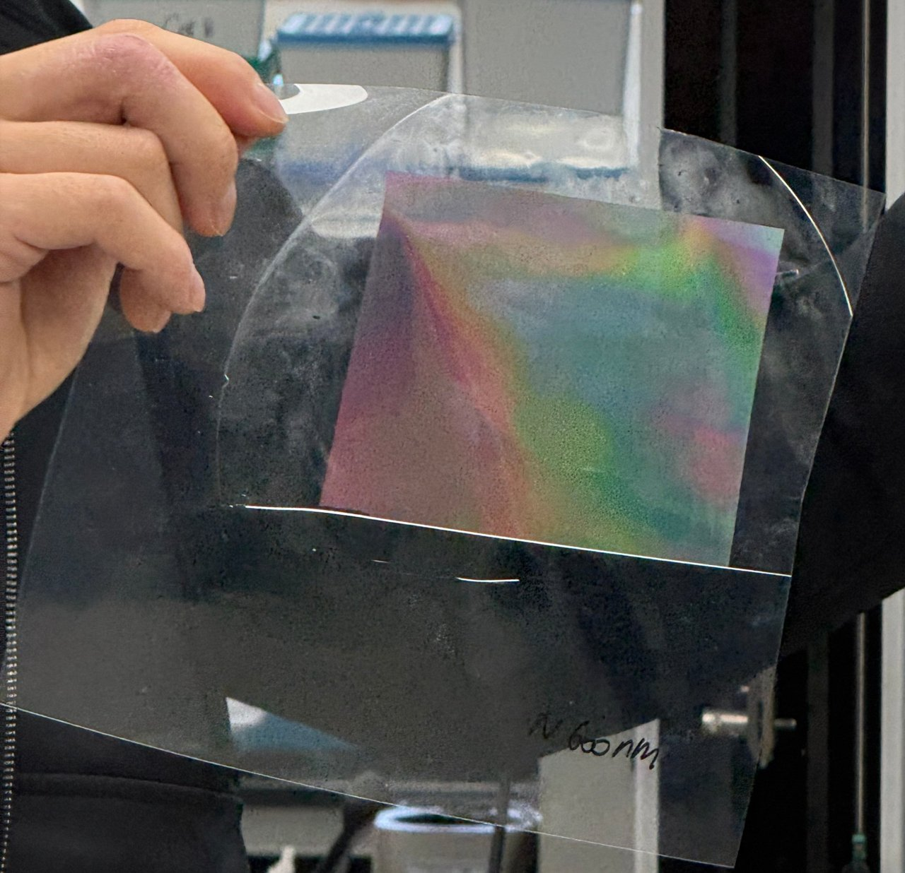
(b) 패턴 필름

그림 4-9. 패턴 웨이퍼와 비교용 패턴 필름

### 4.6 단계별 확인 항목

제작 과정에서는 다음 단계로 넘어가기 전에 현재 상태를 확인하는 것이 중요하다. 세척 후에는 표면의 이물과 잔류액을 확인하고, PET를 덮은 뒤에는 수지가 작업 영역에 분포하는지 살펴본다. 롤러 작업 후에는 기포와 들뜸, 가장자리의 수지 번짐을 확인한다. 특히 이번 원판의 기존 파손부는 정상 영역과 구별하여 관찰해야 한다.

챔버로 옮길 때에는 원판과 필름이 서로 미끄러지거나 한쪽이 들리지 않도록 지지한다. 조사 후에는 수지층이 PET에 지지된 상태로 분리 가능한지 확인하고, 탈형 중 균열이나 원판 잔류물이 생기는지 살펴본다. 분리한 시편에는 사용 수지, 원판 종류와 앞뒤 방향을 구분할 수 있는 표시를 남긴다.

약 24시간 안정화는 탈형 후의 시편 관리 단계로 구분하였다. 그 시간을 추가 조사 시간이나 경화 완료의 측정값으로 취급하지 않았다. 반복 제작에서는 안정화 전후에 같은 위치의 외관과 치수를 비교하면 휨이나 수축 여부를 판단하는 데 도움이 된다. 이번에는 안정화에 따른 치수 변화나 가교율을 정량 측정하지 않았다.

## 5. 결과

재료별로 한 일과 관찰한 내용은 표 5-1에, 실습 중 확인한 장비 표시값과 공정 조건은 표 5-2에 정리했다.

표 5-1. 재료별 수행 내용과 관찰 결과

| 재료 | 수행 내용 | 관찰 결과 |
| --- | --- | --- |
| PUA (MINS-311RM) | 플랫 웨이퍼 위에 PUA 도포, PET 덮기, 롤러 밀착, UV 경화, 박리, 표시 | 투명한 평탄 필름 분리. 받침 종이에 수지 번짐 자국 |
| PDMS | 원료와 제작 순서 설명 | 베이스 라벨에 비닐 말단 실록산 성분 확인. 직접 제작하지 않음 |
| PCL·PLGA | 나노 패턴 디스크 관찰 | 원형 비교용 시편의 일부 면에서 각도에 따른 색 변화 |
| 비교용 패턴 필름 | 패턴 웨이퍼로 만든 필름 관찰 | 패턴 영역의 각도에 따른 색 변화. 실제 패턴 치수 미측정 |

표 5-2. 장비 표시값과 공정 조건

| 항목 | 값 | 비고 |
| --- | --- | --- |
| 건조 오븐 (DAIHAN Air Dry Oven) | 설정 90 °C / 현재 92 °C | 촬영 시점의 표시값. 실제 시편 온도와 구별 |
| UV-A 경화 챔버 타이머 | 40.0 | 단위 표기가 없어 초·분 확인 못 함 |
| 실제 UV 조사 시간 | 정량 확인하지 못함 | 타이머의 단위·모드 확인 필요 |
| 사용 수지 / 기판 | MINS-311RM / PET 필름 | 라벨 사진으로 확인 |

우리 조가 만든 플랫 PUA 필름은 투명한 외관을 보였으며, 비교용 패턴 필름에서 나타난 뚜렷한 무지개색 영역과 구별되었다(그림 5-1). PET를 들어 올리자 수지층이 PET에 지지된 채 원판에서 분리되었다. 받침 종이에는 웨이퍼 가장자리로 퍼진 수지 자국이 남아 있었다(그림 4-4 (b)). 또한 롤러로 밀착하는 동안 기존에 깨져 있던 원판 가장자리에서 기포 제거가 어려웠다. 이 관찰은 해당 부위의 접촉 문제를 보여 주지만, 필름 전체의 두께나 경화율을 정량 평가한 결과는 아니다.

그림 5-1. 우리 조가 만든 플랫 PUA 필름

## 6. 고찰

### 6.1 열로 굳히기와 빛으로 굳히기

PDMS와 PUA는 모두 액체 속 사슬이 서로 이어져 그물 구조를 이루면서 굳는다. 차이는 반응을 일으키는 방법에 있다. PDMS는 섞는 순간 촉매 반응이 시작되고 열이 그 속도를 높이므로 섞는 비율과 온도가 공정을 정한다. PUA는 빛을 쬘 때 광개시제가 라디칼을 만들어 반응이 시작되므로 빛의 세기와 시간이 공정을 정한다. 두 방식의 차이는 표 6-1에 정리했다.

표 6-1. PDMS 열경화와 PUA 광경화의 비교

| 구분 | PDMS | PUA |
| --- | --- | --- |
| 반응이 시작되는 때 | 베이스와 경화제를 섞을 때 | UV를 쬘 때 |
| 반응 | 백금 촉매 하이드로실릴화 | 라디칼 광중합 |
| 속도를 정하는 조건 | 혼합비, 온도 | 빛의 파장, 세기, 시간 |
| 경화 시간 (참고) | 100 °C 35분, 25 °C 48시간 | 광원과 수지층 조건에 따라 달라짐 |
| 쓰는 장비 | 저울, 진공 챔버, 핫플레이트·오븐 | 피펫, 롤러, UV 경화 챔버 |

이 차이는 작업 순서에도 영향을 준다. 2성분 PDMS는 혼합 후 반응이 진행되므로 제품이 안내하는 작업 가능 시간 안에 탈포와 성형을 해야 한다. PUA는 수지에 적합한 빛이 닿을 때 반응하므로, 도포와 밀착 중에도 불필요한 광 노출을 줄여야 한다. 경화 방식이 다르므로 장비와 조건을 단순히 바꾸어 적용할 수 없으며, 수지층의 두께와 작업 목적에 맞는 조건을 확인해야 한다.

### 6.2 기포를 없애는 두 가지 방법

PDMS의 진공 탈포와 PUA의 롤러 밀착은 공기 포획을 줄인다는 목적은 같지만 작용 방식이 다르다. 진공은 혼합물 내부의 기포를 팽창시켜 제거를 돕고, 롤러는 PET로 지지된 얇은 수지층의 공기를 가장자리로 이동시킨다. 후자의 경우 공기가 빠져나갈 경로와 표면의 평탄성이 중요하다. 우리 조는 원판의 깨진 가장자리에서 PET 밀착이 불균일해져 기포 제거가 어려운 것을 경험하였다.

파손부에서 기포 제거가 어려웠던 경험을 바탕으로, 힘을 크게 가하는 것만으로 문제를 해결하기는 어렵다고 생각하였다. 가장자리의 높이와 지지 상태가 달라 PET가 들뜨면 공기가 다시 유입될 수 있다고 해석하였다. 다만 기포 잔류에는 수지량이나 롤러 이동 방식도 영향을 줄 수 있으므로, 원판 파손만을 유일한 원인으로 단정하지 않았다. 이 경험을 통해 경화 전에 원판 상태와 밀착 상태를 확인하는 과정이 중요하다고 느꼈다.

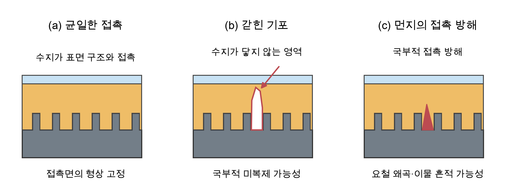
그림 6-1. 수지 밀착 상태와 공기 포획에 따른 결함의 개념도

그림 6-1은 기포가 갇힌 경우와 밀착이 유지된 경우의 차이를 설명하는 개념도이다. 이번 시편의 단면을 측정한 그림은 아니다. 기포가 남으면 그 위치에서 접촉이 끊기거나 수지층 두께가 달라질 수 있으므로, 조명과 관찰 각도를 바꿔 경화 전의 상태를 확인하는 것이 도움이 된다. 나노패턴 원판을 사용하는 경우에도 기포 영역은 정상적인 표면 형상 복제를 방해할 수 있다.

### 6.3 원판과 복제본

원판과 접촉한 수지가 경화되면 그 면의 형상이 복제면에 반영된다. 따라서 의도한 패턴뿐 아니라 먼지나 흠집도 품질에 영향을 줄 수 있다. 탈형에서는 수지층이 PET에 지지되고 원판에서 안정적으로 분리되는 접촉 관계가 중요하다. 단단한 수지는 형상 유지에 유리할 수 있지만 취성이나 응력 집중을 함께 고려해야 하며, 유연한 수지는 휘어지는 용도에 적합할 수 있다. 어느 등급이 더 좋은지는 필름 두께, 구조와 사용 목적을 함께 평가해야 한다.

이번에 제작한 플랫 필름은 나노패턴 형성에 성공한 시편으로 해석하지 않았다. 대신 패턴이 없는 면에서 동일한 재료와 공정을 적용하는 기본 시편으로 볼 수 있다. 향후 같은 수지, 두께와 조사 조건으로 패턴 시편을 제작하면 평탄 시편과 비교해 표면 구조의 영향을 구분할 수 있다. 비교의 기준은 색의 유무뿐 아니라 표면 형상과 결함의 분포가 되어야 한다.

### 6.4 생체재료로서의 고분자

PDMS는 탄성과 투명성을 활용하는 실험용 재료이며, PCL과 PLGA는 생분해성 지지체에 연구된다 [8]. 세포가 접촉하는 재료는 기계적 성질뿐 아니라 젖음성, 표면의 화학 조성, 잔류물과 표면 구조도 고려해야 한다. PCL처럼 소수성이 큰 재료는 세포 부착에 불리할 수 있어 적절한 표면 처리가 필요할 수 있다 [9]. 문헌에서는 나노구조가 세포의 형태, 정렬과 이동에 영향을 주는 사례가 보고되어 있다 [14]. 우리 조의 평탄 필름 제작은 이와 같은 표면 연구를 이해하기 위한 공정 실습이며, 세포 실험이나 생체적합성 평가를 수행한 결과는 아니다.

### 6.5 한계와 보완할 점

우리 조는 플랫 웨이퍼와 MINS-311RM 한 등급을 사용했으므로 나노패턴의 복제 정확도와 두 PUA 등급의 물성 차이를 직접 비교하지 못했다. 실제 UV 조사 시간과 조사 세기, 수지 도포량, PET 두께 및 롤러의 압력과 속도도 정량 측정하지 않았다. 따라서 평탄 필름 제작과 외관 관찰을 중심으로 결과를 해석하였다. 다음 제작에서는 공정 조건을 시편 번호와 함께 관리하고, 파손부가 없는 원판에서 같은 조건을 반복해 가장자리 기포의 변화를 비교하는 것이 적절하다.

패턴 치수를 확인할 때에는 관찰 방법의 한계도 고려해야 한다. 육안의 무지개색과 광학현미경 사진은 표면 구조를 이해하는 단서가 될 수 있지만, 나노구조의 선폭·높이·반복 간격을 모두 정량 확인하는 근거로 충분하지 않을 수 있다. 패턴 원판과 복제 시편의 동일 영역을 SEM으로 관찰하거나 AFM으로 높이 정보를 측정하면 형상과 치수 차이를 비교할 수 있다. 이 분석은 다음 실험에서 수행할 보완 과제이다.

### 6.6 공정 조건의 비교와 재현성

기포 제거 방법을 개선하려면 한 번에 여러 조건을 바꾸기보다 비교할 변수 하나를 정하고 나머지 조건을 일정하게 유지해야 한다. 예를 들어 롤러의 이동 방식을 비교할 때에는 같은 수지와 원판, 도포량, PET 및 조사 조건을 사용한다. 먼저 파손부가 없는 원판에서 기준 시편을 만들고, 경화 전 기포 상태와 탈형 후 외관을 같은 조명과 각도에서 기록하는 것이 적절하다.

이번에 경험한 가장자리 기포는 위치 정보와 함께 비교해야 한다. 원판의 기존 손상부를 표시한 사진, PET를 덮은 뒤의 밀착면 사진, 탈형 후 같은 영역의 사진을 대응시키면 공정 중 발생한 문제와 원판의 기존 결함을 구별하는 데 도움이 된다. 사진 장수는 제작 시편 수나 반복 실험 횟수와 다르므로, 각각의 시편 번호와 제작 조건을 함께 관리해야 한다.

정량 평가에서는 전체 면적 중 기포나 들뜸이 차지하는 비율, 위치별 필름 두께와 분리 시 손상 범위를 측정할 수 있다. 탄성계수나 접착력, 접촉각을 평가하려면 각각에 맞는 시험을 수행해야 한다. 외관이 투명하고 쉽게 분리되었다는 관찰만으로 기계적 성질이나 완전 경화를 판단하는 것은 적절하지 않다. 이러한 항목을 추가하면 제작 성공 여부와 품질의 차이를 더 명확히 비교할 수 있다.

## 7. 결론

이번 실습에서는 합성 고분자 네 종류의 가공 원리를 비교하고, MINS-311RM과 PET를 이용하여 플랫 PUA 필름을 제작하였다. PDMS와 PUA는 가교 반응으로 경화하며, PCL과 PLGA의 성형은 용매 제거나 열가소성 가공과 구별하여 이해하였다. 우리 조는 도포, 롤러 밀착, UV 경화와 탈형을 수행하고, 탈형 후 약 24시간 안정화하는 절차를 익혔다. 기존에 깨진 원판 가장자리에서는 기포 제거가 어려워, 재료 특성뿐 아니라 원판의 상태와 균일한 접촉이 제작 품질에 중요하다는 점을 확인하였다.

## 8. 참고문헌

[1] World Health Organization, 「Radiation: Ultraviolet (UV) radiation」, https://www.who.int/news-room/questions-and-answers/item/radiation-ultraviolet-(uv), 2026.10.07

[2] MilliporeSigma, 「SYLGARD 184 Silicone Elastomer Kit (761036)」, https://www.sigmaaldrich.com/product/aldrich/761036, 2026.10.13

[3] Z. Brounstein, J. Zhao, D. Geller, N. Gupta, A. Labouriau, 「Long-Term Thermal Aging of Modified Sylgard 184 Formulations」, Polymers 13(18), MDPI, 2021, 3125

[4] Dow, 「SYLGARD 184 Silicone Elastomer Kit」, https://www.dow.com/en-us/pdp.sylgard-184-silicone-elastomer-kit.01064291z.html, 2026.10.13

[5] M. Seong, H.-H. Park, I. Hwang, H. E. Jeong, 「Strong and Reversible Adhesion of Interlocked 3D-Microarchitectures」, Coatings 9(1), MDPI, 2019, 48

[6] M. Lang, S. Hirner, F. Wiesbrock, P. Fuchs, 「A Review on Modeling Cure Kinetics and Mechanisms of Photopolymerization」, Polymers 14(10), MDPI, 2022, 2074

[7] S. M. Kim 외, 「Repeated Shape Recovery of Clustered Nanopillars by Mechanical Pulling」 보충 자료, Journal of Materials Chemistry C, Royal Society of Chemistry, 2016, https://www.rsc.org/suppdata/c6/tc/c6tc02660e/c6tc02660e1.pdf

[8] M. Rosalia 외, 「Investigation on Electrospun and Solvent-Casted PCL-PLGA Blends Scaffolds Embedded with Induced Pluripotent Stem Cells for Tissue Engineering」, Pharmaceutics 15(12), MDPI, 2023, 2736

[9] M. Dolatkhahan, M. Peiravi, Z. Sherafat, 「Morphology and Mechanical Properties of 3D Porous PLA/PCL Scaffolds」, Iranian Journal of Materials Forming 11(3), Shiraz University, 2024, 21–27

[10] Opsytec Dr. Gröbel, 「UV Curing and Photopolymerization」, https://www.opsytec.com/uv-applications/uv-processes/uv-curing-photopolymerization, 2026.10.13

[11] S. Jang, H.-J. Jeon, C. J. An, M. L. Jin, H.-T. Jung, 「10 nm scale nanopatterning on flexible substrates by secondary sputtering phenomenon and their applications in high performance, flexible and transparent conducting films」 보충 자료, Journal of Materials Chemistry C, Royal Society of Chemistry, 2014, https://www.rsc.org/suppdata/tc/c4/c4tc00012a/c4tc00012a1.pdf

[12] J.-H. Shin, S.-H. Lee, K.-J. Byeon, K.-S. Han, H. Lee, K. Tsunozaki, 「Fabrication of flexible UV nanoimprint mold with fluorinated polymer-coated PET film」, Nanoscale Research Letters 6, Springer, 2011, 458

[13] Physics LibreTexts (UC Davis Physics 9B), 「Diffraction Gratings」, https://phys.libretexts.org/Courses/University_of_California_Davis/UCD:_Physics_9B__Waves_Sound_Optics_Thermodynamics_and_Fluids/03:_Physical_Optics/3.03:_Diffraction_Gratings, 2026.10.13

[14] D.-H. Kim, P. P. Provenzano, C. L. Smith, A. Levchenko, 「Matrix nanotopography as a regulator of cell function」, Journal of Cell Biology 197(3), Rockefeller University Press, 2012, 351

[15] E. Ko 외, 「Matrix Topography Regulates Synaptic Transmission at the Neuromuscular Junction」, Advanced Science 6(6), 2019, 1801521. DOI: 10.1002/advs.201801521. https://pmc.ncbi.nlm.nih.gov/articles/PMC6425454/
